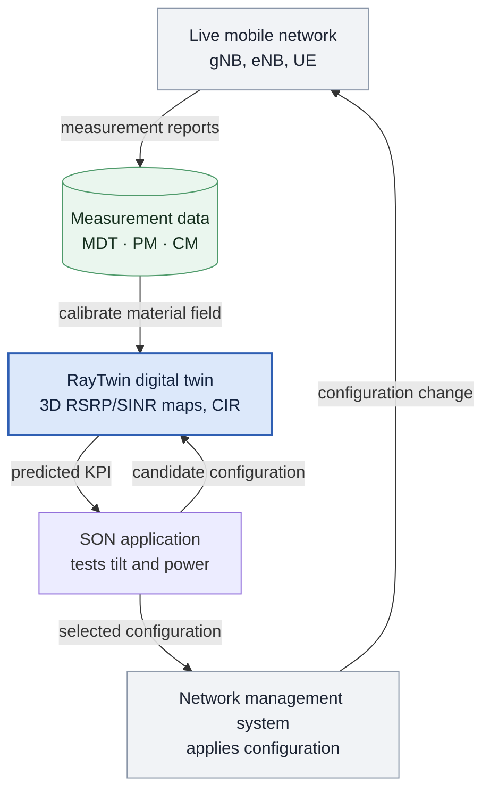
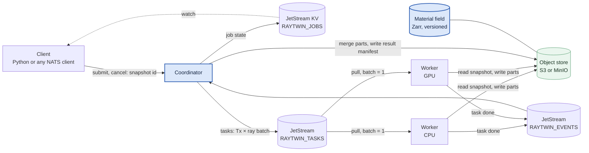
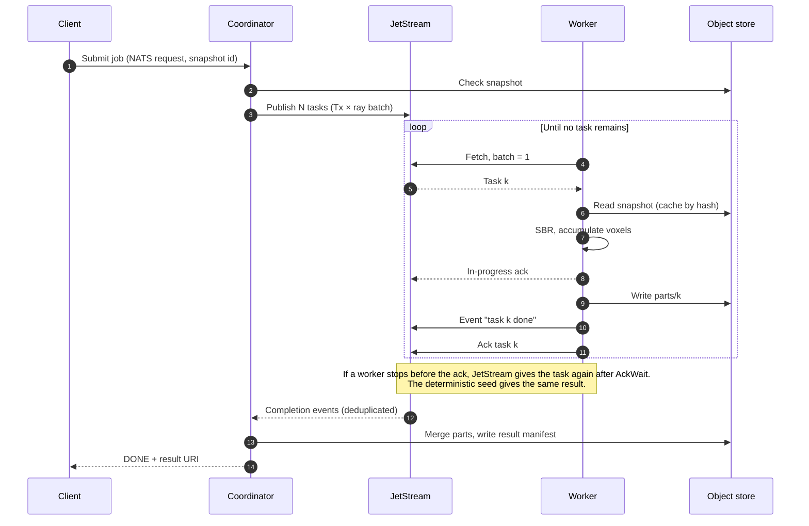
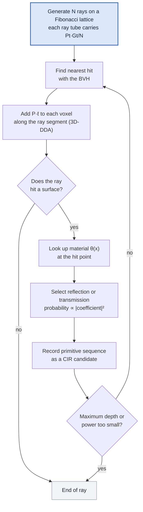
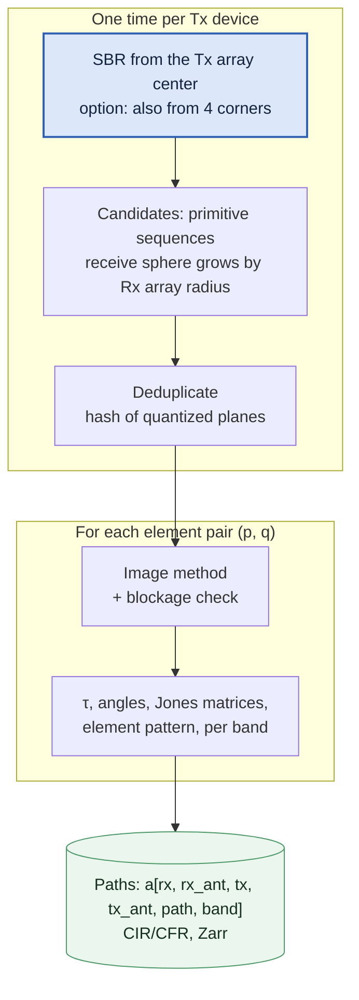
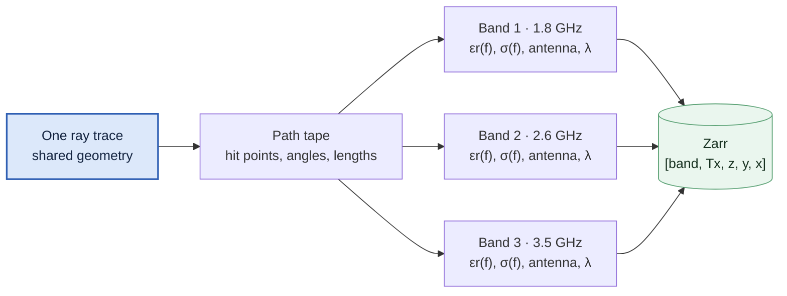
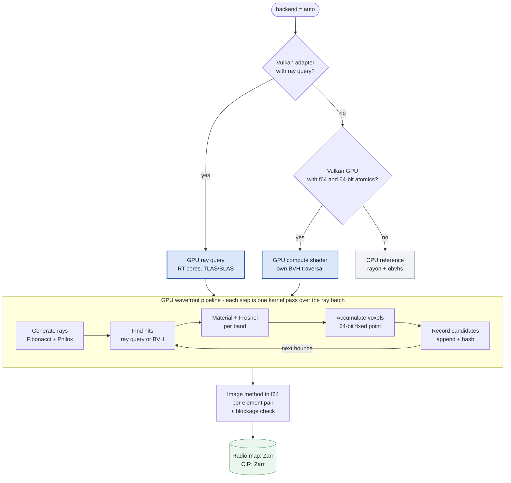
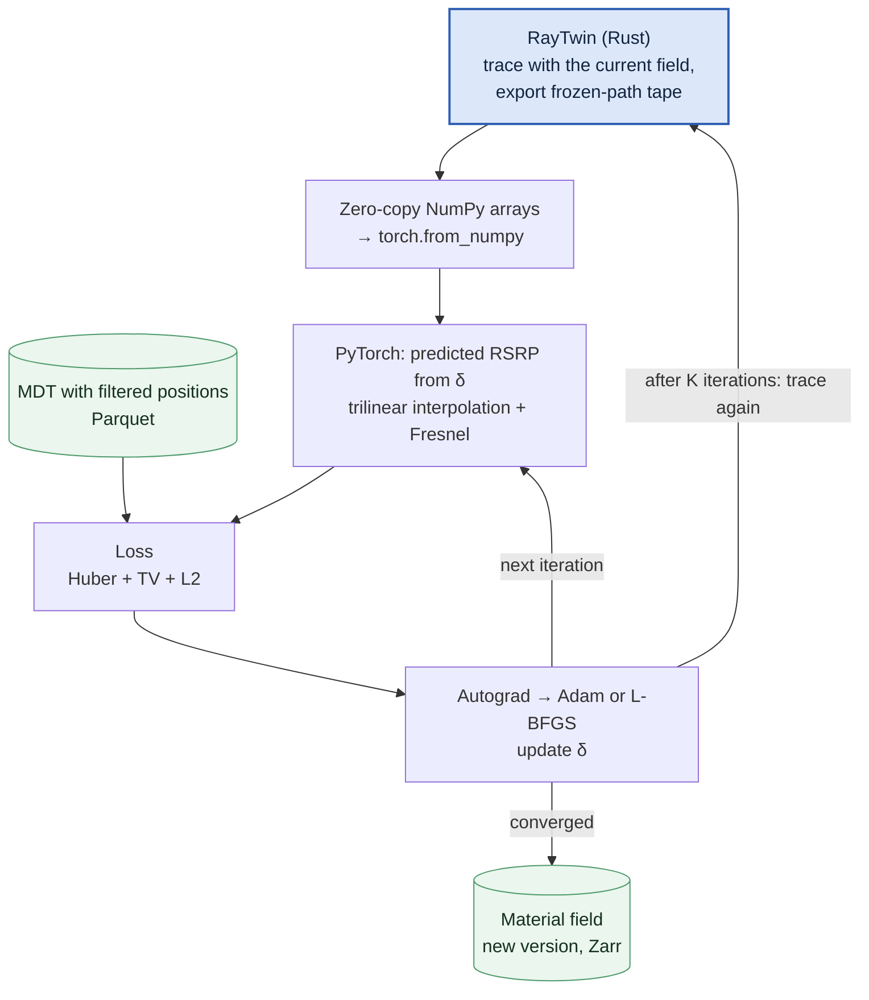
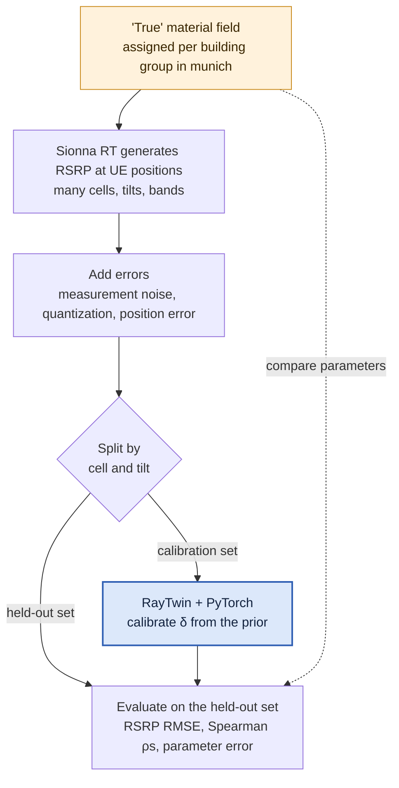
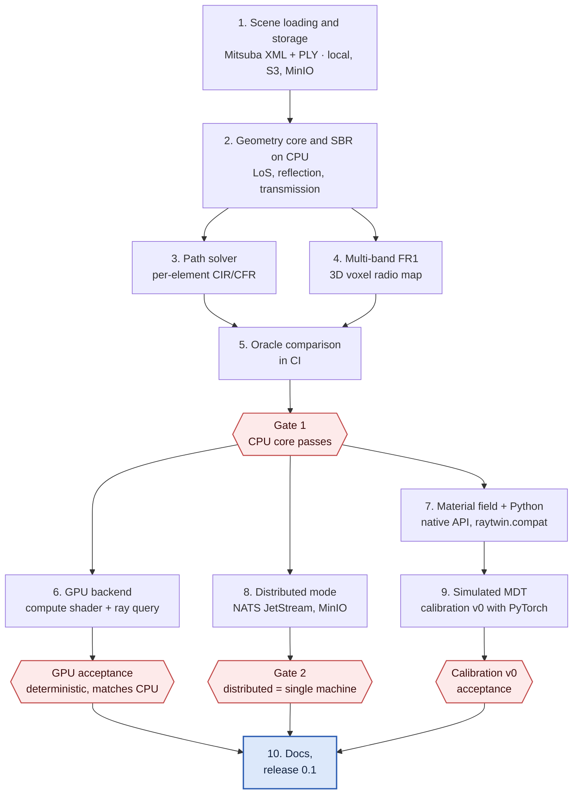

# RayTwin

RayTwin is a Rust ray-tracing engine that calculates versioned 3D radio maps and channel impulse responses for digital twins of self-organizing mobile networks.

[](LICENSE)

## Status and ownership

| | |
|---|---|
| **Maturity** | Design (pre-alpha). The repository has no code yet. The MVP target is release 0.1. |
| **Owner** | Nguyễn Duy Vũ |
| **Contact** | [GitHub Issues](https://github.com/NguyenVu04/ray-twin/issues) |
| **Source of record** | <https://github.com/NguyenVu04/ray-twin> |
| **Issue tracker** | <https://github.com/NguyenVu04/ray-twin/issues> |
| **Architecture** | [`docs/architecture/ARCHITECTURE.md`](docs/architecture/ARCHITECTURE.md) |
| **Decisions** | [`docs/architecture/adr/`](docs/architecture/adr/README.md) and [section 10 of the architecture](docs/architecture/ARCHITECTURE.md#10-decisions-and-rationale) |

## Contents

- [Overview](#overview)
- [Architecture](#architecture)
- [How it works](#how-it-works)
- [Compute backends](#compute-backends)
- [Material field and calibration](#material-field-and-calibration)
- [Service-quality simulation (release 0.2)](#service-quality-simulation-release-02)
- [Getting started](#getting-started)
- [Configuration](#configuration)
- [Usage](#usage)
- [Development](#development)
- [Testing](#testing)
- [Build and deployment](#build-and-deployment)
- [Roadmap](#roadmap)
- [License](#license)
- [References](#references)

## Overview

A self-organizing network (SON) must answer "what-if" questions before it changes a live mobile network. A typical question is: "If the tilt of cell 17 increases by 2°, how do coverage and interference change?" A test on the live network is slow and has operational risk. A digital twin lets the SON application test the change on a numerical model first.

RayTwin is the radio propagation core of that digital twin. It traces rays through a 3D model of the area and calculates two outputs:

- **Average-power radio maps** (path gain, RSRP, SINR) on a 3D voxel grid. SON uses these maps for coverage, interference, and load-balancing tasks.
- **Channel impulse responses (CIR) per antenna element** at discrete receiver points. SON uses these for link-level tasks such as beam selection, delay spread, and precoding.

RayTwin stores every input of a simulation in an immutable, content-hashed snapshot. It calibrates a position-dependent material field from measurement data. It gives the same result for the same seed. Thus Monte Carlo noise does not hide the difference between two candidate configurations. RayTwin runs in one process as a library, or on many machines as a distributed service.

### Capabilities

The MVP (release 0.1) contains these capabilities:

- A shooting-and-bouncing-rays (SBR) core on CPU and GPU. It models line of sight (LoS), specular reflection, and transmission through thin slabs.
- CIR and CFR per antenna element, for transmitter arrays up to 64T64R and user equipment (UE) with up to 4 antennas.
- 3D voxel radio maps for several FR1 bands from one ray trace.
- A position-dependent material field with versions.
- Scene loading from local disk, S3, or MinIO.
- A distributed mode with work distribution through NATS JetStream.
- A Python API, a Sionna-compatible API layer (`raytwin.compat`), and calibration with PyTorch.
- Self-describing results. Each result array has its grid, its band and transmitter ids, the coordinate reference of the scene, and the ray-segment count of each voxel.
- A 3D viewer in Jupyter, and a glTF export of the scene, a map slice, and the ray paths.
- A public release 0.1 with Python wheels for Linux, macOS, and Windows.

Release 0.2 adds service-quality simulation from MDT and a plugin API. Release 0.3 adds antenna-pattern and material tables, scene importers, and a SON loop. See [Roadmap](#roadmap).

### Glossary

| Term | Meaning | Example |
|---|---|---|
| SON | Self-Organizing Network. The network configures, optimizes, and repairs itself from measurement data. | Decrease the tilt of a cell that causes interference in a neighbor area. |
| Digital twin | A numerical model of the real network. Measurement data updates the model continuously. | Test 5 tilt values on the twin. Apply only the best value to the live network. |
| RSRP | Reference Signal Received Power. The average power per resource element (RE) that carries a reference signal, in dBm. | −92 dBm is a typical urban value. |
| SINR | The ratio of the wanted signal power to the sum of co-channel interference and thermal noise. | 20 dB SINR means that the signal is 100 times stronger than interference plus noise. |
| RAN config | The radio parameters that act only when RayTwin reads a result: reference-signal power per resource element (EPRE), cell on/off state, noise figure, UE gain, and from release 0.2 offsets and handover parameters. It has its own hash. | A change of the cell individual offset needs no new trace. |
| Cell load | The fraction of the resource blocks of a cell that its users need. | A load of 0.74 means that the users need 74 % of the blocks. |
| User association, CIO | The selection of the serving cell of each user. The cell individual offset (CIO) adds to the RSRP of one cell when the UE compares cells. | A CIO of +3 dB moves users at the cell edge to that cell. |
| Handover, event A3 | A handover moves a user to another cell. Event A3 starts it when a neighbor cell is better than the serving cell by an offset for a time to trigger (TTT). | Hysteresis 1 dB, offset 3 dB, TTT 320 ms. |
| MDT | Minimization of Drive Tests (3GPP TS 37.320). The phone records and reports measurements, such as RSRP and, when available, a GNSS position. | A sample without GNSS has only a cell ID and an RF fingerprint, so its position is not accurate. |
| CM, PM | Configuration Management (power, tilt, azimuth, antenna type). Performance Management (KPI statistics over time). | An incorrect CM tilt value causes an incorrect calibration of the materials. |
| FR1, FR2-1, FR2-2 | 5G NR frequency ranges: 410–7125 MHz, 24.25–52.6 GHz, 52.6–71 GHz (TS 38.101-2 §5.1). | Band n78 (3.5 GHz) is in FR1. |
| 64T64R | A base station with 64 transmit and 64 receive branches. RayTwin models it as 64 antenna ports, that is 32 positions with 2 polarizations each. | A 4 × 8 dual-polarized array. |
| Path gain, path loss | Path gain is received power divided by transmitted power for isotropic antennas. Path loss is the inverse, in dB. | A path gain of −83 dB is a path loss of 83 dB. |
| CIR, CFR | Channel Impulse Response: a list of paths, each with a complex amplitude and a delay. Channel Frequency Response: the Fourier transform of the CIR. | LoS at 104 ns, wall reflection at 114 ns. |
| SBR | Shooting and Bouncing Rays. A Monte Carlo method that launches many rays and follows each ray through its interactions. | 10⁶ rays per transmitter. |
| Image method | An exact method to find a reflected path. It mirrors the source across the reflecting plane and connects the image to the receiver. | See [Image method](#image-method). |
| BVH | Bounding Volume Hierarchy. A tree of nested boxes that makes the ray–triangle search fast. | A scene with 268 000 triangles. |
| Voxel | A 3D cell of the radio map grid. | 5 m × 5 m × 5 m. |
| Track-length estimator | An estimate of the power density in a voxel. It adds the power of each ray multiplied by the ray length inside the voxel. | See [3D radio map](#3d-radio-map-track-length-estimator). |
| Snapshot, manifest | A snapshot is an immutable set of all simulation inputs. The manifest describes the snapshot. Its content hash identifies the snapshot. | Same hash, same result. |
| Frozen paths, tape | RayTwin traces rays one time and records the paths (hit points, angles, lengths) in a tape. A material change then needs no new trace. | The base of the PyTorch calibration loop. |
| Twin experiment | A test of an algorithm on data that comes from a known "true" model. | Generate RSRP from a known material field and check that calibration recovers it. |
| Gate | A checkpoint in the plan. Work continues only when the gate criteria pass. | Gate 1: the physics core matches the reference. |

### Where RayTwin fits in a SON loop



For SON, a stable result is as important as an accurate one. When SON compares two tilt values, Monte Carlo noise can be larger than the difference that SON must measure. For this reason, RayTwin uses a deterministic seed and common random numbers for all configurations in one comparison.

## Architecture

One Rust core crate serves two execution modes. Library mode runs everything in one process. Distributed mode separates a coordinator from workers and sends work through NATS JetStream. All persistent state is in an object store as versioned snapshots.



In library mode, the Python API calls `raytwin-core` in the same process. Library mode needs no coordinator, no NATS server, and no separate worker.

### Design principles

1. **Separate the core from the runtime.** `raytwin-core` contains all the physics. The distributed layer and the Python layer are thin wrappers. Thus the two modes give the same results.
2. **Immutable snapshots, identified by content hash.** The manifest contains the geometry, material field, antennas, bands, and solver parameters, including the seed. The snapshot id does not include URIs. RayTwin checks the hash of each input when it reads the input, and it never overwrites an object. Workers cache data by hash, so they do not need to synchronize state ([ADR 0002](docs/architecture/adr/0002-snapshot-identity-and-path-based-storage.md)).
3. **Split work by transmitter × ray batch.** A radio map is an incoherent sum of power. Thus the sum of partial maps is equal to the full map. For a very large area, RayTwin also splits the area into tiles with a buffer zone.
4. **Internal traits in release 0.1, plugins from release 0.2.** In release 0.1, a trait exists only where two or more implementations exist, which is only `Backend`. From release 0.2, Python plugins in the client process extend data input, service-quality models, KPIs, and export. From release 0.3, antenna patterns and materials can be tables in the snapshot. No plugin code runs in the Rust crates or on the workers ([ADR 0004](docs/architecture/adr/0004-plugin-api.md)).
5. **Determinism.** The random-number key is (manifest seed, Tx), and the counter is (global ray index, bounce). The key contains no job id and no batch index. Every backend and every partial result accumulates with 64-bit fixed-point integers. Thus the result does not depend on thread count, worker count, batch size, or merge order. Two jobs that compare two tilt values use the same random numbers. Each transmitter has its own key and its own fixed-point scale, so a change of one transmitter does not change the results of the others. This also makes it safe to run a task again after a worker failure ([ADR 0003](docs/architecture/adr/0003-deterministic-monte-carlo-with-fixed-point-accumulation.md)).
6. **One trace, many bands.** All bands share the path geometry. Each worker calculates the field and the accumulation for all bands of its ray batch.

### Components

| Component | Responsibility | Location |
|---|---|---|
| `raytwin-core` | Geometry, BVH, SBR, image method, materials, antennas, voxel radio map, CIR. No network or Python dependency. | `raytwin-core` crate (planned) |
| `raytwin-store` | Read and write snapshots, manifests, and Zarr arrays through `object_store` (local, S3, MinIO). Check input hashes. Parse Mitsuba XML and PLY. | `raytwin-store` crate (planned) |
| `raytwin-dist` | Coordinator, worker, task queue on NATS JetStream, NATS job protocol (submit, cancel, job state). Binary `raytwin` with the subcommands `coordinator` and `worker`. | `raytwin-dist` crate (planned) |
| `raytwin-py` (package `raytwin`) | PyO3 binding: native API, `raytwin.compat` (Sionna-compatible names), `raytwin.calib` (PyTorch calibration), `raytwin.mdt` (canonical MDT input), `raytwin.viz` (3D viewer). From release 0.2 also `raytwin.qos` (service quality) and `raytwin.plugins`. | `raytwin-py` crate (planned) |

### Data model: snapshot and manifest

A manifest describes all inputs of one simulation. The hash of the manifest identifies the snapshot. Two runs with the same hash give the same result. The hash covers the canonical manifest (RFC 8785) without its URI fields. Thus the same scene on local disk, MinIO, or S3 gets the same snapshot id. Inputs stay at the paths that the user selects. RayTwin checks each hash when it reads the input, and it writes every object create-only. When calibration makes a new material field, only the field gets a new version. The geometry and the antennas keep their hashes.

The snapshot holds only the inputs of the ray trace. The scene can have a coordinate reference (`crs`: an EPSG code and the origin of the scene coordinates). RayTwin uses it to convert MDT positions. Radio parameters are in a separate RAN config with its own hash, so a change of power, offset, or handover parameters needs no new trace. An edit never changes a snapshot or a RAN config. A config delta makes a new one with a new hash. From release 0.2, a named reference records the history of a plan, and a rollback adds an entry that points to an earlier configuration ([ADR 0002](docs/architecture/adr/0002-snapshot-identity-and-path-based-storage.md)).

Example manifest (illustrative, not a fixed format):

```json
{
  "schema": "raytwin.manifest/v1",
  "scene": { "uri": "s3://raytwin/scenes/munich/munich.xml", "hash": "blake3:9f2c…",
             "crs": { "epsg": 32632, "origin": [691000.0, 5334000.0, 0.0] } },
  "materials": { "prior": "itu-classes",
                 "field": { "uri": "s3://raytwin/fields/munich/v3.zarr", "hash": "blake3:7a01…" } },
  "bands": [
    { "id": "b3",  "f_center": 1.8e9, "bandwidth": 2.0e7, "n_sub": 1 },
    { "id": "n78", "f_center": 3.5e9, "bandwidth": 1.0e8, "n_sub": 1 }
  ],
  "transmitters": [
    { "id": "cell-17", "position": [8.5, 21.0, 27.0], "azimuth_deg": 120, "tilt_deg": 6,
      "bands": ["b3", "n78"],
      "array": { "rows": 4, "cols": 8, "dual_pol": true, "spacing_lambda": [0.5, 0.5], "pattern": "tr38901" } }
  ],
  "solver": { "max_depth": 3, "rays_per_tx": 10000000, "seed": 42 }
}
```

### Execution modes

| | Library mode | Distributed mode |
|---|---|---|
| Processes | One process | Client, coordinator, N workers |
| Task dispatch | Parallel iteration over the tasks (`rayon`), no queue | NATS JetStream pull consumer |
| Compute | CPU (rayon) or GPU (wgpu) | Each worker uses the CPU or GPU of its machine |
| Storage | Local disk is sufficient | S3 or MinIO |
| Use | Research, notebooks, CI | Large areas, many transmitters |

The two modes use the same `Task` type and the same two functions, `run_task` and `merge`. The compute core does not know which mode it runs in ([ADR 0001](docs/architecture/adr/0001-one-core-two-runtime-modes.md)).

### Work distribution with NATS JetStream

**Decided.** Workers pull tasks. The coordinator does not push tasks to workers. A fast worker thus takes more tasks. A new worker needs no coordinator change. JetStream gives the task of a failed worker to another worker automatically.

The sequence for one radio-map job:



| Decision | Reason |
|---|---|
| Stream `RAYTWIN_TASKS` with WorkQueue retention. One shared durable pull consumer `workers`, batch = 1. | Exactly one worker completes each task. Tasks are heavy, so a worker pulls one task at a time for an even load. |
| The worker sends in-progress acks more frequently than `AckWait` (default 30 s). | A ray batch can run longer than 30 s. Without the ack, JetStream gives the same task to a second worker. |
| `MaxDeliver` is finite (for example 5). The coordinator monitors the advisories. | The default value (−1) gives a permanently failing task again without limit. The coordinator must mark the job as failed. |
| A message contains only references: manifest hash, Tx, ray range, result key. | Messages stay much smaller than the 1 MB `max_payload` default. Large data goes through S3 or MinIO. |
| Worker order: write result, then publish the "done" event, then ack. | If a worker stops at any step, the task runs again with the same result. The second write is create-only, and it counts as success when the hash agrees. The coordinator deduplicates events by task ID. |
| Stream `RAYTWIN_EVENTS` for completion and failure events. KV bucket `RAYTWIN_JOBS` for job state. | The coordinator tracks progress without a listing of the object store. |
| Subjects per job: `raytwin.tasks.<job>.<task>`. | The coordinator can purge all queued tasks of one job when the job is cancelled or fails ([D-05](docs/architecture/ARCHITECTURE.md#10-decisions-and-rationale)). |
| Three task kinds: `radio_map` (Tx × ray batch, merged by integer addition), `paths` and `tape` (Tx × receiver group or MDT sample group, merged by concatenation in task order). | Calibration also runs in distributed mode. `paths` and `tape` need no global deduplication. |
| Clients submit with a request on `raytwin.jobs.submit` and cancel with a request on `raytwin.jobs.cancel`. They watch the job state in the KV bucket. | One protocol serves clients and workers. The coordinator and the workers open no listening port ([D-06](docs/architecture/ARCHITECTURE.md#10-decisions-and-rationale)). |
| The job id is the hash of the canonical job spec. | A second submission is safe. A running job returns its state, a finished job returns its result, and a failed or cancelled job runs again. |
| To cancel, the coordinator sets the state to `cancelled` and purges the queued tasks. A worker reads the state at each in-progress tick and stops between two ray sub-batches. | No new task of the job starts after the reply. A running task stops within about one tick (10 s). |

Example task message:

```json
{ "job": "4c1e…", "task": 37, "kind": "radio_map",
  "snapshot": "blake3:9a7d…", "manifest": "s3://raytwin/snapshots/9a7d….json",
  "tx": "cell-17", "rays": [37000000, 38000000], "scale": 1.0e-12,
  "out": "s3://raytwin/jobs/4c1e…/parts/37.zarr" }
```

For CIR jobs, the coordinator splits tasks by (Tx, receiver group), not by ray batch. With a split by ray batch, two workers can find the same path, and a global deduplication becomes necessary.

### Extension points

**Decided.** Release 0.1 has no public plugin API ([ADR 0004](docs/architecture/adr/0004-plugin-api.md)). A WGSL shader cannot call a Rust trait object, so a plugin trait would not run on the GPU backends. The only trait is the internal seam `Backend`, which has three implementations. It is not part of the stable API. The signature below is illustrative.

```rust
/// Cpu (rayon + obvhs), GpuCompute (WGSL, own BVH traversal), GpuRayQuery (Vulkan, RT cores).
/// Same input and seed: bit-identical between runs. GPU within 1e-4 of the CPU.
pub trait Backend: Send + Sync {
    fn caps(&self) -> BackendCaps; // ray query, f64, 64-bit atomics, VRAM
    fn upload(&mut self, snapshot: &Snapshot) -> Result<()>;
    fn trace_map(&self, task: &MapTask, cancel: &CancelFlag) -> Result<FixedPointMap>;
    fn trace_paths(&self, task: &PathTask, cancel: &CancelFlag) -> Result<Paths>; // SBR + per-element image method
    fn trace_tape(&self, task: &TapeTask, cancel: &CancelFlag) -> Result<Tape>; // frozen paths for calibration
}
```

The other points are concrete types. `MaterialField` is a struct (ITU class prior plus δ grid). `AntennaPattern` is an enum (isotropic, dipole, TR 38.901). Interactions are functions (specular reflection, thin-slab transmission).

**Decided.** From release 0.2, plugins extend RayTwin outside the trace kernel ([ADR 0004](docs/architecture/adr/0004-plugin-api.md)). A code plugin is a Python distribution that registers an entry point in one plugin group. RayTwin finds it with `importlib.metadata` from the standard library. Code plugins run only in the client process.

| # | Plugin group | The plugin supplies | Release |
|---|---|---|---|
| PL-01 | `raytwin.mdt_readers` | A reader of MDT, PM, or CM data to the canonical MDT schema | 0.2 |
| PL-02 | `raytwin.qos.association` | The selection of the serving cell | 0.2 |
| PL-03 | `raytwin.qos.link` | The map from SINR to rate | 0.2 |
| PL-04 | `raytwin.qos.sharing` | The sharing of cell resources between users | 0.2 |
| PL-05 | `raytwin.qos.mobility` | Trajectories and the handover decision | 0.2 |
| PL-06 | `raytwin.qos.scenario` | The user population and the traffic | 0.2 |
| PL-07 | `raytwin.kpi`, `raytwin.exporters` | KPI definitions, and export to GeoTIFF, Parquet, or dashboards | 0.2 |
| PL-08 | `raytwin.pattern_readers` | A reader of vendor antenna files to a pattern table | 0.3 |
| PL-09 | Table in the snapshot | Material parameters as functions of frequency | 0.3 |
| PL-10 | `raytwin.scene_importers` | A converter of CityGML, OSM, or glTF to the scene format | 0.3 |
| PL-11 | `raytwin.son.policies` | A SON policy that proposes configurations | 0.3 |

Antenna patterns and material tables are data, not code. They enter the snapshot with a hash, and the CPU and the GPU interpolate them in the same way. Each code plugin declares an API version. Its name, version, and parameters are part of the run id, so a cached result never belongs to another plugin. A plugin uses only the random generator that RayTwin gives it. RayTwin provides no physics plugins, no WGSL plugins, and no Rust libraries that load at run time.

### External dependencies

Criticality states the effect on RayTwin when the dependency is not available. **Critical**: RayTwin does not work. **Degraded**: RayTwin loses a feature. **Optional**: no user-visible effect.

| Dependency | Purpose | Criticality | Owner |
|---|---|---|---|
| `obvhs` | BVH build and SIMD traversal on CPU | Critical | obvhs maintainers |
| `wgpu` (pinned version) | GPU backends: compute shader and experimental ray query | Degraded (CPU backend remains) | gfx-rs |
| `rayon` | Data-parallel loops on CPU threads | Critical | rayon maintainers |
| `object_store` | Access to local disk, S3, and MinIO | Critical | Apache Arrow |
| `zarrs` | Chunked N-dimensional arrays (radio maps, material field) | Critical | zarrs maintainers |
| `async-nats` (JetStream) | Task queue and client job protocol in distributed mode | Degraded (library mode remains) | NATS (Synadia) |
| NATS server with JetStream | Message broker in distributed mode | Degraded (library mode remains) | NATS (Synadia) |
| S3 or MinIO | Snapshot and result storage in distributed mode | Degraded (local disk remains) | Deployment operator |
| PyO3, maturin, `rust-numpy` | Python binding, wheels, zero-copy arrays | Degraded (Rust API remains) | PyO3 project |
| PyTorch | Calibration loop | Degraded (no calibration) | PyTorch Foundation |
| pyarrow | MDT input in Parquet | Degraded (no MDT input) | Apache Arrow |
| trimesh | 3D viewer and glTF export | Optional (no viewer) | trimesh maintainers |
| Plugin packages (release 0.2) | Readers, service-quality models, KPIs, exporters | Optional (built-in plugins remain) | Plugin authors |
| Sionna RT 2.2.0 (pinned) | Reference oracle in CI, generator of simulated MDT | Optional at runtime, critical for CI | NVIDIA |

## How it works

This section gives the formulas that `raytwin-core` implements, in the order that a ray goes through the system. Each subsection has a numerical example on the same small scene.

### Free-space path loss and link budget

In free space, the power of an isotropic source spreads over a sphere of radius $d$. The path gain between two isotropic antennas is:

```math
g_{\mathrm{FS}}(d) = \left(\frac{\lambda}{4\pi d}\right)^{2}, \qquad \mathrm{PL}_{\mathrm{dB}}(d) = 20\log_{10}\frac{4\pi d}{\lambda}
```

Here $\lambda = c/f$ is the wavelength. Ray tracing applies this formula to each path. The path length sets the spreading loss. Each surface hit multiplies the amplitude by an interaction coefficient.

> **Example: path loss at 3.5 GHz.**
> $\lambda = 3\cdot10^{8} / 3.5\cdot10^{9} \approx 8.57$ cm.
> At $d = 100$ m, $\mathrm{PL} = 20\log_{10}(4\pi\cdot100/0.0857) \approx 83.3$ dB.
> At $d = 500$ m, $\mathrm{PL} \approx 97.3$ dB.
> Five times the distance adds $20\log_{10}5 \approx 14$ dB.

RayTwin calculates RSRP from the link budget per resource element (RE):

```math
\mathrm{RSRP}\,[\mathrm{dBm}] = P_{\mathrm{RE}} + G_t + G_r - \mathrm{PL}, \qquad
\mathrm{SINR} = \frac{S}{\sum_{j} I_j + N}, \qquad
N\,[\mathrm{dBm}] = -174 + 10\log_{10}\Delta f + \mathrm{NF}
```

The interference sum $\sum_j I_j$ contains only cells on the same carrier frequency. $N$ is the thermal noise in one RE of width $\Delta f$. $\mathrm{NF}$ is the receiver noise figure.

> **Example: RSRP and SNR.**
> Assumption: the cell transmits 46 dBm over 273 PRB × 12 = 3276 subcarriers (100 MHz, 30 kHz spacing). The transmit antenna gain is 17 dBi, the UE antenna gain is 0 dBi, the path loss is 120 dB, and NF = 7 dB.
>
> 1. $P_{\mathrm{RE}} = 46 - 10\log_{10}3276 \approx 10.85$ dBm.
> 2. $\mathrm{RSRP} \approx 10.85 + 17 + 0 - 120 \approx -92.2$ dBm.
> 3. Noise per RE: $-174 + 10\log_{10}(30\,000) + 7 \approx -122.2$ dBm.
> 4. Without interference, $\mathrm{SNR} \approx -92.2 - (-122.2) = 30$ dB.

### Materials and Fresnel coefficients

When a ray hits a surface, part of the energy reflects and part of it goes through. The complex relative permittivity $\eta$ of the material sets the ratio. ITU-R P.2040 gives $\varepsilon_r$ and $\sigma$ as functions of frequency $f$ (in GHz), with four parameters $a, b, c, d$ per material:

```math
\eta = \varepsilon_r - j\,\frac{\sigma}{\varepsilon_0\,\omega}, \qquad
\varepsilon_r = a\,f_{\mathrm{GHz}}^{\,b}, \qquad
\sigma = c\,f_{\mathrm{GHz}}^{\,d}\ \ [\mathrm{S/m}]
```

For an incidence angle $\vartheta$ from the surface normal, the Fresnel reflection coefficients for the two polarizations are:

```math
r_{\perp} = \frac{\cos\vartheta - \sqrt{\eta - \sin^{2}\vartheta}}{\cos\vartheta + \sqrt{\eta - \sin^{2}\vartheta}}, \qquad
r_{\parallel} = \frac{\eta\cos\vartheta - \sqrt{\eta - \sin^{2}\vartheta}}{\eta\cos\vartheta + \sqrt{\eta - \sin^{2}\vartheta}}
```

$r_\perp$ (TE) applies when the electric field is perpendicular to the plane of incidence. $r_\parallel$ (TM) applies when the electric field is in the plane of incidence. The RayTwin core uses a slab model with thickness, and puts the two polarizations in a 2 × 2 Jones matrix.

> **Example: concrete at 3.5 GHz.**
> The ITU parameters of concrete are $a = 5.24$, $b = 0$, $c = 0.0462$, $d = 0.7822$ (valid from 1 to 100 GHz).
> Thus $\varepsilon_r = 5.24$ and $\sigma = 0.0462\cdot3.5^{0.7822} \approx 0.123$ S/m.
> Then $\sigma/(\varepsilon_0\omega) \approx 0.632$, so $\eta \approx 5.24 - j0.632$.
>
> | Incidence angle $\vartheta$ | $\lvert r_\perp\rvert$ (TE) | $\lvert r_\parallel\rvert$ (TM) |
> |---|---|---|
> | 0° | 0.395 (−8.1 dB) | 0.395 (−8.1 dB) |
> | 45° | 0.512 (−5.8 dB) | 0.263 (−11.6 dB) |
> | 65.8° | 0.675 (−3.4 dB) | 0.027 (−31.2 dB) |
>
> This example uses a half-space model and ignores the wall thickness. At 65.8°, TM almost does not reflect, because the angle is near the Brewster angle $\arctan\sqrt{5.24} \approx 66.4°$. An incorrect polarization model can thus cause an error of tens of dB.

### Shooting and bouncing rays (SBR)

SBR launches $N$ rays from each transmitter in directions that are almost uniform on the sphere. RayTwin uses a Fibonacci lattice, with the golden ratio $\Phi = (1 + \sqrt5)/2$:

```math
\theta_i = \arccos\!\left(1 - \frac{2\,(i + \tfrac12)}{N}\right), \qquad
\varphi_i = \frac{2\pi\, i}{\Phi}, \qquad i = 0,\dots,N-1
```

Each ray represents a ray tube with the initial power $P_t\,G_t(\theta_i, \varphi_i)/N$. At each hit, the algorithm looks up the material. It then selects reflection or transmission at random, with a probability proportional to the squared coefficient. The ray stops at the maximum depth or when its power is too small. Russian roulette can remove low-power rays and keep the estimate unbiased.



One loop does two jobs. It accumulates the voxel radio map and it records path candidates for the CIR.

SBR is a Monte Carlo method. The relative error of a voxel value is approximately $1/\sqrt{n}$, where $n$ is the number of ray segments in the voxel. A voxel with about 100 segments has an error of about 10%, that is about 0.4 dB. Far or shadowed areas get fewer rays, so they have more noise.

### Image method

SBR shows only approximately which surfaces a ray hit. For an exact CIR, RayTwin solves each candidate sequence of reflecting surfaces again with the image method. The image of point $\mathbf{x}$ across a plane through $\mathbf{p}_0$ with unit normal $\hat{\mathbf{n}}$ is:

```math
\mathbf{x}' = \mathbf{x} - 2\,\big((\mathbf{x} - \mathbf{p}_0)\cdot\hat{\mathbf{n}}\big)\,\hat{\mathbf{n}}
```

For multiple reflections, the method mirrors the source across each surface in sequence. It then traces back from the receiver to find the reflection points. A path is valid only when each reflection point is inside its triangle (or a coplanar triangle) and no segment is blocked.

> **Example: one reflection on a wall (top view, z axis not shown).**
> The wall is the plane $x = 10$ m with $\hat{\mathbf{n}} = (1, 0, 0)$. Tx = (2, 0, 10). Rx = (4, 30, 1.5).
>
> 1. Mirror Tx across the wall: Tx′ = (18, 0, 10).
> 2. Connect Tx′ to Rx. The segment hits the plane $x = 10$ at parameter $t = 8/14$, so P = (10, 17.14, 5.14).
> 3. Check that P is inside the wall triangle and that the segments Tx→P and P→Rx are not blocked.
> 4. The path length is $\lvert \mathrm{Tx}' - \mathrm{Rx}\rvert = \sqrt{14^2 + 30^2 + 8.5^2} \approx 34.18$ m.
>
> The LoS path is $\sqrt{2^2 + 30^2 + 8.5^2} \approx 31.24$ m. The incidence angle is $\cos\vartheta = 14/34.18$, so $\vartheta \approx 65.8°$.

### CIR and CFR

With $N$ paths, the CIR is a sum of impulses at delays $\tau_n$. The CFR is its Fourier transform:

```math
h(\tau) = \sum_{n=1}^{N} a_n\,\delta(\tau - \tau_n), \qquad
H(f) = \sum_{n=1}^{N} a_n\,e^{-j2\pi f \tau_n}, \qquad
\tau_n = \frac{L_n}{c}
```

$L_n$ is the length of path $n$. The complex coefficient $a_n$ contains the spreading loss, the interaction coefficients (Jones matrices), and the transmit and receive antenna patterns. The full per-band, per-element form is:

```math
a_{n,b} = \frac{\lambda_b}{4\pi}\, \mathbf{C}_{R,b}^{\mathsf{H}}\, A_n\, \mathbf{T}_{n,b}^{(\ell)} \cdots \mathbf{T}_{n,b}^{(1)}\, \mathbf{C}_{T,b}
```

$A_n$ is the spreading factor ($1/L_n$ for a specular path). $\mathbf{T}^{(k)}$ is the 2 × 2 Jones matrix of interaction $k$. $\mathbf{C}_T$ and $\mathbf{C}_R$ are the dual-polarization antenna patterns. All bands share $\tau_n$, the angles, and $A_n$. Only $\mathbf{T}$, $\mathbf{C}$, and $\lambda$ change per band $b$.

A radio map of average power needs only $\sum_n \lvert a_n\rvert^2$. The CIR also keeps the phase and the delay of each path.

> **Example: a two-path channel at 3.5 GHz (same scene as above).**
>
> - LoS: $\tau_0 = 31.24/c \approx 104.2$ ns, $\lvert a_0\rvert = \lambda/(4\pi\cdot31.24) \approx 2.18\cdot10^{-4}$ (−73.2 dB).
> - Reflection: $\tau_1 \approx 114.0$ ns. Assume TE polarization: $\lvert a_1\rvert = \lvert r_\perp\rvert\cdot\lambda/(4\pi\cdot34.18) \approx 0.676\cdot2.0\cdot10^{-4} \approx 1.35\cdot10^{-4}$ (−77.4 dB).
>
> ```math
> \lvert H(f)\rvert = \left\lvert a_0 + a_1 e^{-j2\pi f \Delta\tau}\right\rvert, \qquad \Delta\tau = \tau_1 - \tau_0 \approx 9.79\ \mathrm{ns}
> ```
>
> $\lvert H(f)\rvert$ changes between $\lvert a_0\rvert + \lvert a_1\rvert \approx -69.0$ dB and $\lvert a_0\rvert - \lvert a_1\rvert \approx -81.6$ dB. The fading notches are about 12.5 dB deep. Two adjacent notches are $1/\Delta\tau \approx 102$ MHz apart, so one 100 MHz channel can contain a full notch. An average-power map does not show this effect. The CIR shows it.

### 3D radio map: track-length estimator

The volumetric radio map estimates the average power flux density in each voxel $v$. It adds the power of each ray multiplied by the length of the ray segment inside the voxel:

```math
\bar{S}_v = \frac{1}{V}\sum_i P_i\,\ell_{i,v}, \qquad g_v = \frac{\lambda^2}{4\pi P_t}\,\bar{S}_v
```

$P_i$ is the power of ray tube $i$ (W). $\ell_{i,v}$ is the segment length of ray $i$ in voxel $v$. $V$ is the voxel volume. $g_v$ is the path gain for an isotropic receiver, and $\lambda^2/4\pi$ is the effective area of an isotropic antenna. The 3D-DDA algorithm (Amanatides–Woo) finds the voxels along each segment. Each step moves to the next voxel that the ray enters.

The estimator contains the $1/r^2$ loss without an explicit term. In free space at distance $r$, the number of rays through a voxel with cross-section $A$ is proportional to $A/(4\pi r^2)$. Each ray adds $P_t/N$ multiplied by a length $L = V/A$:

```math
\bar{S}_v \approx \frac{1}{V}\cdot\frac{N A}{4\pi r^2}\cdot\frac{P_t}{N}\cdot L = \frac{P_t}{4\pi r^2}
\quad\Rightarrow\quad g_v = \left(\frac{\lambda}{4\pi r}\right)^2
```

The result is equal to the Friis formula above.

> **Example: radio map size.**
> An area of 1 km × 1 km × 60 m with 5 m voxels has 200 × 200 × 12 = 480 000 voxels. This is about 1.92 MB of float32 for each (Tx, band) pair. With 50 transmitters and 4 bands, the map needs about 384 MB. For this reason, RayTwin stores maps in chunks and does not write empty chunks.

### Antenna arrays: synthetic and per-element

Each element $q$ of an array is at position $\mathbf{r}_q$ relative to the array center. A plane wave from direction $\hat{\mathbf{k}}$ gives each element a phase shift that depends on its position. Synthetic mode traces rays only from the array center. It then calculates each element coefficient with a steering vector:

```math
a_{n,q} \approx a_n \exp\!\left(j\,\frac{2\pi}{\lambda}\,\hat{\mathbf{k}}_n^{\mathsf{T}}\mathbf{r}_q\right), \qquad d_F = \frac{2D^2}{\lambda}
```

This approximation is correct when the receiver is farther than the Fraunhofer distance $d_F$. $D$ is the largest dimension of the array. Per-element mode solves the paths for each element separately. It stays correct when the receiver is near the array or when the elements have different blockage.

> **Example: Fraunhofer distance.**
>
> - A 4 × 8 array with λ/2 spacing at 3.5 GHz: $D \approx 0.38$ m, so $d_F \approx 3.4$ m.
> - A 16 × 16 array with λ/2 spacing at 28 GHz: $D \approx 0.12$ m, so $d_F \approx 2.7$ m.
>
> Beyond a few meters, synthetic mode is almost equal to per-element mode for LoS and reflection. **Decided:** the CIR uses per-element mode. The radio map uses synthetic mode to save compute.

RayTwin does not trace rays again for each element. It finds the interaction sequences one time per device, and solves the exact geometry again for each element pair:



The path index stays the same for all element pairs, with a validity mask per pair. Thus one path can be followed across the full array. With $k = 1$ (center only) or $k = 5$ (center and 4 corners), $N_S$ rays, depth $d$, $N_c$ candidates, and $M$ element positions, the cost is:

```math
C_{\mathrm{SBR}} \propto k\,N_S\,d, \qquad C_{\mathrm{IM}} \propto N_c\,M_{tx}\,M_{rx}\,d
```

> **Example: the decided configuration.**
> A 64T64R transmitter has $M_{tx} = 32$ dual-polarized positions. The UE has up to 4 antennas, so $M_{rx} = 4$. With $N_c = 100$ and $d = 3$, the image method needs about 32 · 4 · 100 · 3 = 38 400 checks per link. This is small compared to $N_S = 10^6$ SBR rays.
>
> The output has 64 × 4 coefficients per path and band. With 100 paths in complex64 (8 bytes), this is 64 · 4 · 100 · 8 = 204 800 bytes, about 200 KB per link and band. For this reason, RayTwin calculates per-element CIR only at discrete receiver points.

### Multi-band: one trace, many bands

In geometrical optics, the ray trajectory does not depend on frequency. Thus one ray trace can serve many bands. Only the field calculation (Fresnel coefficients, antenna pattern, wavelength, accumulation) repeats for each band.



| Component | Multi-band design |
|---|---|
| Band declaration | `BandSpec { id, f_center, bandwidth, n_sub }` in the manifest. Each cell has its bands, RS power per RE, and antenna. |
| Ray trace | One trace for all bands. The interaction type is selected at a reference frequency. Each band applies a correction weight. |
| Materials | ITU parameters (a, b, c, d) per class. The calibration offsets are shared by all bands. A warning shows when a band is outside the valid range of a material. |
| Antennas | Pattern, tilt, and azimuth per (cell, band). |
| Radio map | Band axis: Zarr `[band, Tx, z, y, x]`, chunked by band and Tx. SINR adds interference only from cells on the same carrier. |
| Distributed mode | Split by Tx × ray batch. Each worker writes all bands for its batch. |
| MDT | Samples are separated by carrier frequency. |
| Wideband | The MVP uses the center frequency. When necessary, a band splits into $n_{sub}$ sub-frequencies and the powers are added. |

The interaction type is selected at the reference frequency. Thus the ray power in band $b$ must use an importance weight to keep the estimate unbiased:

```math
\bar{S}_{v,b} = \frac{1}{V}\sum_i P_{i,b}\,\ell_{i,v}, \qquad
P_{i,b} = \frac{P_{t,b}\,G_{t,b}(\theta_i,\varphi_i)}{N}\prod_k \frac{\lvert c_{k,b}\rvert^2}{q_k}
```

$c_{k,b}$ is the coefficient of interaction $k$ of ray $i$ in band $b$. $q_k$ is the probability of the selected interaction at the reference frequency. The condition is $q_k > 0$ wherever the coefficient of any band is not zero.

> **Example: band weight.**
> A ray hits a concrete wall. At the reference frequency, $\lvert r\rvert^2 = 0.16$ and $\lvert t\rvert^2 = 0.84$. The algorithm thus selects reflection with probability $q = 0.16$. In band $b$, $\lvert r_b\rvert^2 = 0.20$. The reflected ray power in band $b$ is multiplied by $0.20/0.16 = 1.25$. Over many rays, the reflected energy fraction in band $b$ is 0.20. The estimate is thus unbiased.

Multi-band data also helps calibration. In $\eta = \varepsilon_r - j\sigma/(\varepsilon_0\omega)$, the term $\sigma/(\varepsilon_0\omega)$ changes with frequency, but $\varepsilon_r$ does not change in the same way. RSRP in several bands thus helps to separate $\varepsilon_r$ from $\sigma$. It also gives a natural validation: calibrate in one band and test in another band.

**Decided:** the MVP validates only FR1. FR2-1 and FR2-2 come after the MVP. The data types for bands, materials, and antennas have no frequency limit, so FR2 needs no architecture change.

## Compute backends

**Decided.** The MVP runs on CPU and GPU. The CPU backend (rayon + obvhs) is the reference. The GPU backend uses wgpu with two paths, selected at run time:

- **Ray query** uses RT cores when the adapter is Vulkan and supports the feature (`Features::EXPERIMENTAL_RAY_QUERY`). This wgpu feature is experimental.
- **Compute shader** with its own BVH traversal in WGSL, in all other cases.

The full pipeline runs on the GPU, including the per-element image method. In the MVP, GPU support is for Linux and Windows through Vulkan. macOS uses the CPU backend.



The two GPU paths differ only in the hit search. All other steps share the same shaders. The configuration can force a specific backend. When an adapter does not have a necessary feature (ray query, f64, 64-bit atomics), RayTwin records the reason and selects the next backend.

| Step | CPU (reference) | GPU compute shader | GPU ray query |
|---|---|---|---|
| Hit search | obvhs, CWBVH with SIMD traversal | Flat BVH, stack traversal in WGSL | `rayQuery` on TLAS/BLAS with RT cores |
| Material lookup | `MaterialField::eval` | Field chunks in a storage buffer, trilinear interpolation in the shader | Same as compute shader |
| Voxel accumulation | 64-bit fixed-point integers, per-thread sums | 64-bit integer atomics on fixed-point values | Same as compute shader |
| CIR candidates, deduplication | Dynamic hash table | Append buffer + atomic hash table, sorted before output | Same as compute shader |
| Image method, blockage | f64 | f64 in the shader (`SHADER_F64`), any-hit with the BVH | f64 in the shader, any-hit with ray query |

### Determinism on the GPU

**Decided.** With the same seed, each GPU path gives a bit-identical result between runs. The difference from the CPU result is at most $10^{-4}$ relative. A GPU runs thousands of threads in no fixed order. The design thus removes every dependency on order:

1. **Counter-based random numbers (Philox).** The random numbers of each ray come from the key (manifest seed, Tx) and the counter (global ray ID, bounce). They do not depend on which thread runs first. The key contains no job id, so two jobs that compare two configurations use the same random numbers.
2. **Fixed-point accumulation in every backend.** The CPU backend and every partial result use the same representation as the GPU. Each contribution $P\cdot\ell$ becomes an integer. A 64-bit atomic add sums it. Integer addition is commutative and associative, so the sum does not depend on order. Atomic floating-point addition does depend on order.
3. **Sorted path lists.** Paths go into an append buffer in any order. RayTwin sorts them by (Tx, Rx, primitive sequence) before output. For duplicates, it keeps the candidate with the smallest ray ID (atomic min).

```math
q_v = \sum_i \operatorname{round}\!\left(\frac{P_i\,\ell_{i,v}}{s}\right) \in \mathbb{Z}, \qquad
\bar{S}_v \approx \frac{s\,q_v}{V}, \qquad
10\log_{10}2^{63} \approx 190\ \mathrm{dB}
```

RayTwin selects the scale $s$ per job from the transmit power, the ray count, and the voxel size. The largest sum must stay below $2^{63}$. The dynamic range of about 190 dB is sufficient for RSRP maps. A contribution smaller than $s$ rounds to 0. For example, a contribution of $3.7\cdot10^{-9}$ with $s = 10^{-12}$ is stored as 3700. The job plan fixes $s$ one time, and every task of the job carries the same $s$. An adapter without 64-bit atomics uses the CPU backend. RayTwin has no 32-bit emulation of 64-bit atomics ([D-07](docs/architecture/ARCHITECTURE.md#10-decisions-and-rationale)).

### Numerical precision of the CIR

The limit $\lvert\Delta\tau\rvert \le 1$ ps is equal to 0.3 mm of path length. With f32, the spacing between two adjacent numbers near 500 m is $2^{-15} \approx 3\cdot10^{-5}$ m. An image method of depth 3 has tens of sequential operations, so the accumulated error can be more than 0.3 mm. For this reason, the GPU image method uses f64 (`SHADER_F64`, Vulkan only), with coordinates in a local origin near the Tx. FP64 is much slower than FP32 on GeForce GPUs, but RayTwin uses it only in the image method. SBR stays in f32.

A ray that grazes a triangle edge can hit on one backend and miss on another backend, because of rounding (FMA) or RT-core hardware. The voxels behind that ray then differ by more than $10^{-4}$. To control this, the CPU and the compute shader use the same watertight ray–triangle test. RayTwin measures the $10^{-4}$ criterion only on voxels with sufficient rays. It also reports the fraction of rays with a different hit or miss result between backends.

### Memory budget on a 4 GB GPU

The estimates below are for the `munich` example scene.

| Item | Estimate |
|---|---|
| Geometry: about 38 900 triangles, f32 vertices, u32 indices, BVH or BLAS/TLAS | A few MB |
| One batch of $10^6$ rays, about 96 bytes of state per ray | About 96 MB |
| Fixed-point 64-bit map, 1 km² × 60 m, 5 m voxels | 3.84 MB per (Tx, band), 15.4 MB for 4 bands |
| CIR 64T64R × UE 4 antennas × 100 paths, complex64 | About 200 KB per link and band |

The total is much smaller than the 4 GB VRAM of the development GPU (RTX 3050 Ti). RayTwin selects the ray batch size and the receiver count per run from the free VRAM. Thus larger scenes, for example 268 000 triangles, can also run.

## Material field and calibration

RayTwin replaces the per-object material assignment with a field $\theta(\mathbf{x})$ that it looks up at each hit point. Each hit adds only one interpolation, so the compute cost is low. The difficult part is to estimate this field from sparse RSRP measurements. These measurements have no phase and have position errors. The field must also keep its physical meaning when the tilt changes.

### Model

The material field has two parts:

1. A **prior per semantic class** $c(\mathbf{x})$ (brick wall, glass, road surface, and so on). It comes from the scene, OSM, CityGML, or image segmentation.
2. A **correction** $\delta(\mathbf{x})$ on a sparse 3D grid with a 2–5 m step, stored as chunked Zarr.

```math
\varepsilon_r(\mathbf{x}, f) = 1 + \left(a_c f^{\,b_c} - 1\right) e^{\delta_\varepsilon(\mathbf{x})}, \qquad
\sigma(\mathbf{x}, f) = c_c\, f^{\,d_c}\, e^{\delta_\sigma(\mathbf{x})}, \qquad c = c(\mathbf{x})
```

This parameterization has four useful properties:

- With $\delta = 0$, the result is exactly the ITU material of the class.
- $\varepsilon_r$ is always larger than 1 and $\sigma$ is always positive, for all values of $\delta$.
- The frequency dependency of the class stays the same, so one $\delta$ serves all bands.
- The correction is multiplicative (in log scale). One update step thus has the same effect on materials with very different $\sigma$.

The value at hit point $\mathbf{x}$ is a trilinear interpolation of the 8 corners of its grid cell. The grid step is $h$ and the relative coordinates are $(u, v, w) \in [0, 1]^3$:

```math
\delta(\mathbf{x}) = \sum_{i,j,k\in\{0,1\}} \omega_i(u)\,\omega_j(v)\,\omega_k(w)\,\delta_{ijk}, \qquad
\omega_1(t) = t,\quad \omega_0(t) = 1 - t
```

> **Example: trilinear interpolation.**
> The grid step is $h = 4$ m. The hit point is (1, 2, 3) m from the cell corner, so $(u, v, w) = (0.25, 0.5, 0.75)$.
> The weight of corner (1, 1, 1) is $0.25\cdot0.5\cdot0.75 \approx 0.094$. The weight of corner (0, 0, 1) is $0.75\cdot0.5\cdot0.75 \approx 0.281$.
> The sum of the 8 weights is 1. Each hit point thus changes the gradient of exactly 8 grid nodes.

RayTwin uses a grid, not a neural network (MLP), for these reasons. A grid supports local updates per chunk and versions. Its interpolation is cheap on CPU and GPU. Explicit regularization controls its generalization.

### Calibration problem

```math
\hat{\delta} = \arg\min_{\delta}\ \sum_m w_m\,\rho_\kappa\!\left(\mathrm{RSRP}_m - \widehat{\mathrm{RSRP}}_m(\delta)\right) + \lambda_1\,\mathrm{TV}(\delta) + \lambda_2\,\lVert\delta\rVert_2^2
```

The sum goes over measurement samples $m$. $w_m$ is a weight from the position confidence of the sample. A sample with GNSS has more weight than a sample with only a cell ID. $\rho_\kappa$ is the Huber function and TV is the total variation on the grid. $\lambda_1$ and $\lambda_2$ set the penalty strength:

```math
\rho_\kappa(r) = \begin{cases} \tfrac12 r^2, & \lvert r\rvert \le \kappa \\ \kappa\left(\lvert r\rvert - \tfrac12\kappa\right), & \lvert r\rvert > \kappa \end{cases}
\qquad
\mathrm{TV}(\delta) = \sum_v \sqrt{\sum_{e\in\{x,y,z\}} \left(\delta_{v+e} - \delta_v\right)^2 + \epsilon^2}
```

> **Example: why Huber.**
> Use $\kappa = 3$ dB. A sample with a 2 dB error adds $\tfrac12\cdot2^2 = 2$, the same as a squared loss.
> A sample with a 10 dB error, often from a position error, adds $3\cdot(10 - 1.5) = 25.5$ instead of $\tfrac12\cdot10^2 = 50$.
> Outliers thus have much less effect on the solution. The small term $\epsilon$ in TV makes the function differentiable at 0.

### Frozen paths and the PyTorch loop

**Decided.** RayTwin does not differentiate the full ray tracer. The Rust core traces rays one time with the current field and records a tape for each measurement sample. The tape contains paths, hit points, incidence angles, interaction types, the 8 interpolation indices and weights per hit, path lengths, and antenna gains. With fixed paths, the predicted RSRP is an analytic function of $\delta$:

```math
\hat{P}_m(\delta) = \sum_{p\in\mathcal{P}_m} P_{\mathrm{RE}}\,G_{t,p}\,G_{r,p}\left(\frac{\lambda}{4\pi L_p}\right)^2 \prod_{k=1}^{K_p}\left\lvert c_{p,k}\!\left(\varepsilon_r(\mathbf{x}_{p,k}), \sigma(\mathbf{x}_{p,k}), \vartheta_{p,k}\right)\right\rvert^2,
\qquad \widehat{\mathrm{RSRP}}_m = 10\log_{10}\hat{P}_m
```

$\mathcal{P}_m$ is the set of paths to sample $m$. $L_p$ is the path length. $c_{p,k}$ is the Fresnel coefficient at hit $k$. The tape goes to Python as zero-copy NumPy arrays (`rust-numpy`), and `torch.from_numpy` wraps them as tensors. PyTorch evaluates the function and calculates the gradient with autograd.



The tape ignores one effect: the set of paths changes with the materials. The reason is that the Fresnel coefficients set the probability to select reflection or transmission. For this reason, the loop traces rays again after every $K$ iterations. The optimization runs in PyTorch, so a researcher can test loss functions, optimizers, and regularization without a Rust rebuild.

**Decided.** Tapes run in both modes ([D-08](docs/architecture/ARCHITECTURE.md#10-decisions-and-rationale)). In library mode, the tape arrays are NumPy views on Rust memory, with no copy. In distributed mode, a job of kind `tape` writes the tapes in Zarr, and Python reads them into NumPy. The Fresnel and thin-slab formulas exist in Rust and in PyTorch. A CI test requires that both agree within $10^{-6}$ when $\delta = 0$.

### The observable: reported RSRP

**Decided.** RayTwin compares its prediction with the value that the UE reports. MDT reports SS-RSRP and SS-RSRQ (3GPP TS 37.320). It does not report the total received power (RSS). SS-RSRP is the average power per resource element that carries the secondary synchronization signal, at the antenna connector of the UE (TS 38.215). A measurement operator converts the path gain $g_{c,b}$ of cell $c$ in band $b$ into the reported value:

```math
\widehat{\mathrm{RSRP}}_{c,b}(\mathbf{x}) = Q\!\left[\mathrm{EPRE}_{c,b} + 10\log_{10} g_{c,b}(\mathbf{x}) + G_{\mathrm{UE}} - L_{\mathrm{body}}\right]
```

$Q$ rounds to 1 dB and clips to the reporting range. The EPRE of the synchronization signal comes from the RAN config. A conversion from total power to RSRP would need assumptions: equal power on all resource elements, no power boost of the synchronization signal, and the same beam pattern for the synchronization signal and the data. If one assumption is wrong, the error is a constant for the cell, and calibration puts it into the material field.

> **Example: a boost of the synchronization signal.**
> A cell transmits 46 dBm on 3276 subcarriers. Equal power gives an EPRE of $46 - 10\log_{10}3276 \approx 10.85$ dBm.
> If the operator boosts the synchronization signal by 3 dB, the real EPRE is 13.85 dBm. A prediction from total power is then 3 dB too low everywhere in the cell.

For massive MIMO cells, release 0.3 uses the envelope of the beams of the synchronization signal as one pattern table. The envelope gives an upper bound of the best-beam RSRP.

### Twin experiment with simulated MDT

**Decided.** The MVP has no real measurement data. The v0 calibration is thus tested with a twin experiment on example scenes:



1. Make a "true" material field on `munich`. Assign different ITU materials, or perturb $\varepsilon_r$ and $\sigma$, per building group. RayTwin starts from a uniform prior per class.
2. Generate RSRP with Sionna RT at UE positions along the streets. Use many cells, many tilts, and at least two FR1 bands.
3. Add errors: measurement noise, quantization per the 3GPP report mapping, position error, and an EPRE error per cell. The fraction of samples with GNSS is a swept parameter. The EPRE error shows how much of a configuration error goes into the material field.
4. Calibrate on a part of the cells and tilts. Evaluate on the held-out part. Report the RSRP RMSE, the material parameter error per building, and the rank correctness between configurations.

A different simulator generates the data, so the experiment avoids the "inverse crime". An inverse crime occurs when the same model generates and inverts the data, and the result is unrealistically good (Wirgin, 2004). Both simulators use the same ITU formulas and the same geometry, so the result is only an upper bound. Real MDT or drive-test data is necessary before a conclusion about calibration quality.

### Identifiability risk and validation

Many $(\varepsilon_r, \sigma)$ pairs give the same reflection magnitude. The calibrated parameters also compensate for geometry errors and model errors, so they are no longer measured material values. A tilt change moves the hit points and the incidence angles. A field that fits well in the current configuration can thus be incorrect in a configuration with no measurements. SON asks exactly this type of question.

For this reason, RayTwin splits the validation set by cell and by configuration (leave-one-cell-out, leave-one-tilt-out), not at random by point. It reports the RMSE and the rank correctness between configurations, measured with the Spearman coefficient of ΔKPI:

```math
\rho_s = 1 - \frac{6\sum_{i=1}^{n} d_i^2}{n\,(n^2 - 1)}
```

> **Example: why measure the rank.**
> SON selects the best tilt from 5 candidates. The predicted rank is (2, 1, 3, 4, 5) and the true rank is (1, 2, 3, 4, 5).
> Then $\sum d^2 = 2$ and $\rho_s = 1 - 6\cdot2/(5\cdot24) = 0.9$.
> For SON, a correct rank is more important than a small absolute error. If the first two candidates change places, SON applies the wrong configuration.

## Service-quality simulation (release 0.2)

A SON application must also know what the users get: throughput, cell load, and handovers. The service-quality layer `raytwin.qos` calculates these values from a radio map, a RAN config, and a scenario. It is a Python module in the client process. It reads results and traces no rays.

A scenario is a set of users with traffic and trajectories, and a seed. It comes from MDT: positions of samples, a user density per voxel scaled to PM counters, or the trajectories of logged MDT. The random generator of a scenario does not use the network configuration. Thus two configurations of one scenario see the same users ([ADR 0003](docs/architecture/adr/0003-deterministic-monte-carlo-with-fixed-point-accumulation.md)).

The model is flow-level. For each time step:

1. **Association.** Each user selects the cell with the highest $\mathrm{RSRP}_c + \mathrm{CIO}_c$ on its carrier.
2. **Load-coupled SINR.** A neighbor cell $j$ interferes only on the fraction $\rho_j$ of its resources that it uses.
3. **Rate.** An attenuated and truncated Shannon formula (3GPP TR 36.942), with a calibrated factor per cell.
4. **Load.** The load of a cell is the sum of user demand divided by user rate. Steps 2 to 4 repeat until the loads are a fixed point.
5. **Throughput.** Full buffer: $R/n$. Elastic traffic: $R(1-\rho)$.
6. **Handover.** A layer-3 filter and event A3 with time to trigger, along each trajectory.

```math
\mathrm{SINR}_u(\boldsymbol{\rho}) = \frac{S_u}{\sum_{j \ne c^*} \rho_j I_{j,u} + N}, \qquad
\rho_c = \min\!\left(1, \sum_{u \in c} \frac{d_u}{R_u(\boldsymbol{\rho})}\right), \qquad
T_u = R_u (1 - \rho_c)
```

> **Example: 25 % more traffic.**
> Two symmetric 100 MHz cells. Each user receives −90 dBm from its cell and −96 dBm from the other cell. The noise is −122.2 dBm per resource element.
> With a demand of 80 Mbit/s per cell, the fixed point is $\rho \approx 0.50$, SINR ≈ 9.0 dB, and throughput ≈ 80 Mbit/s.
> With 100 Mbit/s per cell, $\rho \approx 0.74$, SINR ≈ 7.3 dB, and throughput ≈ 35.6 Mbit/s. The throughput decreases by 56 %, because the load of each cell decreases the SINR of the other cell.

| Change | New trace |
|---|---|
| Offset, power, handover parameters, cell on/off | No. The change is in the RAN config |
| Traffic, number of users, trajectories | No. The change is in the scenario |
| Tilt, azimuth, or antenna of one cell, or a new site | Yes. From release 0.3, only for the changed transmitters |
| Geometry, materials, ray count | Yes, for all transmitters |

The result of a run is a time series in Zarr: user positions, serving cells, RSRP, SINR, throughput, cell load, and handover events. A static scenario has one time step. A viewer can therefore replay a scenario and show the users and the cells at each step.

The layer ranks scenarios. It does not predict the absolute throughput of one user, because the radio map has no fast fading and no beamforming gain of the data channel, and schedulers differ between vendors. It needs MDT with RSRP (M1). Throughput (M5) and PM counters improve the rate model. RayTwin accepts only pseudonymous trace ids.

## Getting started

Not available yet. The project is in the design phase and the repository has no code. Install and run instructions will be part of release 0.1. See [Roadmap](#roadmap).

## Configuration

Not available yet. The configuration settings are not defined. The [snapshot manifest](#data-model-snapshot-and-manifest) describes the planned job inputs.

## Usage

Not available yet. The Python API and the NATS job protocol are in design. [Execution modes](#execution-modes) describes the planned job flow.

## Development

Not available yet. [Components](#components) describes the planned crate layout.

## Testing

Not available yet. The planned validation is the four gates in [Roadmap](#roadmap). CI will compare each physics change with Sionna RT 2.2.0 as a reference oracle. GPU tests will run on a self-hosted runner only for trusted pull requests, or for a fork after the owner adds the `gpu-ok` label ([D-10](docs/architecture/ARCHITECTURE.md#10-decisions-and-rationale)).

## Build and deployment

Not available yet. For the MVP, a Docker Compose stack will start NATS, MinIO, a coordinator, and N workers.

## Roadmap

The MVP must show four results:

1. The physics core matches the reference oracle on the same scene.
2. The GPU gives the same result as the CPU.
3. A distributed run gives the same result as a single-machine run.
4. The twin experiment recovers the position-dependent material field.

The target for the MVP is 1–2 months. This target is a goal, not a commitment. A component is complete when it passes its completion criteria.

### Component order

Arrows show dependencies. Hexagons are gates. A gate is a decision point based on results, not a deadline.



| # | Component | Output | Depends on |
|---|---|---|---|
| 1 | Scene loading and storage | Read Mitsuba XML + PLY from local disk, S3, MinIO. Manifest and content hash. | – |
| 2 | Geometry core and SBR | BVH, SBR with LoS, reflection, transmission. ITU-R P.2040 materials. | 1 |
| 3 | Path solver and CIR | Image method, deduplication, per-element CIR/CFR. | 2 |
| 4 | Multi-band and 3D map | Track-length estimator, band axis, measurement plane, Zarr. | 2 |
| 5 | Oracle comparison in CI | Regression test suite with Sionna RT as the oracle. | 3, 4 |
| 6 | GPU backend | wgpu compute shader and ray query, selected at run time. Full pipeline on GPU. | Gate 1 |
| 7 | Material field and Python | Versioned δ grid. `raytwin`, `raytwin.compat`, `raytwin.calib`. Wheels for 3 operating systems. | Gate 1 |
| 8 | Distributed mode | Coordinator, worker, NATS JetStream (tasks, events, job state, cancellation), tape jobs, Docker Compose + MinIO. | Gate 1 |
| 9 | Simulated MDT and calibration v0 | MDT generator, PyTorch optimization loop. | 7 |
| 10 | Docs, release | Documentation, release 0.1 on crates.io and PyPI. | GPU acceptance, Gate 2, 9 |

### Gates

**Decided.** All four gates and their criteria are decided.

| Gate | Pass condition | If it fails |
|---|---|---|
| Gate 1 – physics core | On `simple_street_canyon` and `munich`, ITU materials, LoS + reflection + transmission, depth ≤ 3, at least two bands (for example 1.8 and 3.5 GHz). Path gain: median difference ≤ 1 dB and P90 ≤ 3 dB on voxels with sufficient rays (≥ 100 segments). CIR: all specular paths of the oracle found, $\lvert\Delta\tau\rvert \le 1$ ps, $\lvert a\rvert$ difference ≤ 0.1 dB, also per element. | Put all effort on the core. Postpone components 6, 7, and 8. |
| GPU acceptance | Both GPU paths: bit-identical between runs, ≤ $10^{-4}$ relative difference from the CPU, CIR passes the Gate 1 limits ($\lvert\Delta\tau\rvert \le 1$ ps). Runs on Linux and Windows through Vulkan with an RTX 3050 Ti 4 GB. | Repair the GPU backend. If only ray query fails, release with the compute shader as the default. |
| Gate 2 – distributed | 4 workers match 1 worker (≤ $10^{-6}$ relative). Speed-up ≥ 3× from 1 to 4 workers. A stopped worker does not change the result. | Keep library mode as the main path. Repair the distributed layer before the release. |
| Calibration v0 acceptance | On held-out cells and tilts: RSRP RMSE decreases by ≥ 30% compared to the prior, and Spearman $\rho_s \ge 0.8$ between tilt configurations. | Review the prior, the regularization, and the grid. Do not include calibration in the release. |

### In and after the MVP

| Area | In the MVP | After the MVP |
|---|---|---|
| Wave interactions | LoS, specular reflection, thin-slab transmission (ITU-R P.2040) | First-order UTD diffraction, diffuse scattering, RIS |
| Outputs | 3D voxel map (track length, 5 m default), measurement plane, CIR/CFR for LoS, reflection, transmission | CIR with diffuse scattering and diffraction, delay spread, angle spread |
| Antennas | Isotropic, dipole, TR 38.901. Tilt, azimuth. Per-element CIR (Tx up to 64T64R, UE up to 4 antennas). Synthetic array for maps. | Vendor patterns, large FR2 arrays, beam codebooks |
| Materials | Class prior + δ grid in Zarr | Hash encoding or MLP, priors from images |
| Scene loading | Mitsuba XML + PLY from local disk, S3, MinIO | glTF, CityGML, automatic OSM, geometry updates from images |
| Execution | CPU (rayon) and GPU (wgpu) on Linux and Windows. Coordinator and workers on NATS JetStream. Docker Compose + MinIO. | GPU on macOS (Metal) and DX12, GPU performance tuning, Kubernetes, autoscaling |
| API and release | Rust crates. Python (PyO3) with native API and `raytwin.compat`. NATS job protocol (submit, watch, cancel). Wheels for Linux, macOS, Windows. Public release 0.1. | gRPC or REST gateway. Plugin API from release 0.2 |
| Service quality | Canonical MDT schema with optional service-quality columns. RAN config. RSRP through the measurement operator | Release 0.2: association, cell load, throughput, handover, replay, scenarios from MDT. Release 0.3: SON loop |
| Viewer and interaction | 3D viewer in Jupyter, glTF export, self-describing results, configuration readable from Python | Release 0.2: edits as config deltas, history, rollback. Later: a web UI for planning engineers |
| Calibration | Twin experiment with simulated MDT. Optimization with PyTorch. | Real MDT import (CSV/Parquet, position filter), continuous calibration, joint CM and material calibration |
| Multi-band | Several FR1 bands in one trace. ITU materials with valid-range checks. Antennas per (cell, band). Band axis in maps. | FR2-1 and FR2-2, wideband split into sub-frequencies, calibrated materials below 1 GHz |

### Priorities after the MVP

1. First-order UTD diffraction and diffuse scattering for the CIR.
2. GPU performance tuning and GPU on macOS.
3. FR2: materials above 40 GHz, atmospheric loss (ITU-R P.676-13), diffuse scattering, and more detailed geometry.
4. Release 0.2: service-quality simulation from MDT, the plugin API, and edits with history and rollback.
5. Release 0.3: antenna-pattern and material tables, scene importers, and a SON loop that traces again only the changed transmitters.

### Interactive planning

A later phase adds a user interface for planning engineers. The design already keeps these extension points open:

- Edits are config deltas with a history and a rollback.
- Each transmitter has an independent result, so an edit traces only the changed transmitters.
- Cells, transmitters, users, scenarios, and jobs have stable ids.
- Results carry their grid and coordinate reference. JSON Schemas describe the documents that a client writes.
- The viewer exports glTF, and service-quality results are time series that a UI can replay.

Before a UI, RayTwin needs authentication and TLS for its protocol, presigned URLs for the object store, and a catalog of scenarios.

## License

MIT — see [LICENSE](LICENSE).

## References

- 3GPP TS 37.320, §5.1.1.3.3, Reporting parameters (MDT). <https://www.3gpp.org/DynaReport/37320.htm>
- 3GPP TS 38.101-2, §5.1 (Rel-19), definitions of FR1, FR2-1, and FR2-2. <https://www.3gpp.org/DynaReport/38101-2.htm>
- ITU-R P.2040, Effects of building materials and structures on radiowave propagation. <https://www.itu.int/rec/R-REC-P.2040>
- ITU-R P.676-13 (08/2022), Attenuation by atmospheric gases. <https://www.itu.int/rec/R-REC-P.676>
- J. Hoydis et al., "Learning Radio Environments by Differentiable Ray Tracing", IEEE TMLCN, 2024. <https://arxiv.org/abs/2311.18558>
- A. Wirgin, "The inverse crime", 2004. <https://arxiv.org/abs/math-ph/0401050>
- J. Amanatides and A. Woo, "A Fast Voxel Traversal Algorithm for Ray Tracing", Eurographics, 1987.
- 3GPP TS 37.320, §5.4.1.1, Immediate MDT measurements for NR. <https://itecspec.com/3gpp/37.320/s/5.4.1.1>
- 3GPP TS 38.215, §5.1.1 and §5.1.3, SS-RSRP and SS-RSRQ. <https://itecspec.com/3gpp/38.215/s/5.1.1>
- 3GPP TS 38.331, §5.5.3.2 and §5.5.4.4, layer-3 filtering and event A3. <https://itecspec.com/3gpp/38.331/s/5.5.4.4>
- 3GPP TR 36.942, Annex A.1, attenuated and truncated Shannon bound. <https://www.itecspec.com/3gpp/36.942/s/a.1>
- I. Siomina and D. Yuan, "Analysis of Cell Load Coupling for LTE Network Planning and Optimization", IEEE TWC, 2012. <https://arxiv.org/abs/1201.4116>
- T. Bonald et al., "Flow-level performance and capacity of wireless networks with user mobility", Queueing Systems, 2009.
- PyPA, Entry points specification. <https://packaging.python.org/specifications/entry-points>
