# RayTwin — software architecture

| | |
|---|---|
| **Document** | Architecture design for RayTwin, a Rust ray-tracing engine that calculates versioned 3D radio maps and per-element channel impulse responses for SON digital twins |
| **Status** | Accepted. ADR 0001 to ADR 0004 and the decisions of section 10 are in force from 2026-10-30 |
| **Date** | 2026-10-29. Updated 2026-10-30 |
| **Author** | Nguyễn Duy Vũ |
| **Source of requirements** | RayTwin technical report (TR) version 1.2 ([`../technical-report.html`](../technical-report.html)) |
| **Related decisions** | [ADR 0001](adr/0001-one-core-two-runtime-modes.md) one physics core for both runtime modes<br>[ADR 0002](adr/0002-snapshot-identity-and-path-based-storage.md) snapshot identity, RAN config, edits and history<br>[ADR 0003](adr/0003-deterministic-monte-carlo-with-fixed-point-accumulation.md) bit-identical results, common random numbers, independent transmitters<br>[ADR 0004](adr/0004-plugin-api.md) plugin API from release 0.2<br>Every other decision: [section 10](#10-decisions-and-rationale) |
| **Related documents** | [`README.md`](../../README.md) for the overview and the physics summary. [`adr/`](adr/README.md) for the decision records |
| **Writing standard** | ASD-STE100 rules for sentence structure. The structural rules apply in full. The word-list rules are advisory |

## Contents

1. [Purpose, scope and audience](#1-purpose-scope-and-audience)
2. [Terms](#2-terms)
3. [How to read this document](#3-how-to-read-this-document)
4. [Drivers and constraints](#4-drivers-and-constraints)
5. [Overall architecture](#5-overall-architecture)
6. [Module view](#6-module-view)
7. [Component-and-connector view](#7-component-and-connector-view)
8. [Deployment view](#8-deployment-view)
9. [Mapping between views](#9-mapping-between-views)
10. [Decisions and rationale](#10-decisions-and-rationale)
11. [Traceability](#11-traceability)
12. [Open items](#12-open-items)

## 1. Purpose, scope and audience

This document gives the architecture of RayTwin. It shows the system in three views:

- The module view shows how the source code is organized.
- The component-and-connector view shows what exists while the system runs.
- The deployment view shows which machines run the components.

It also gives the reason for each significant decision.

The design covers every function of the TR for the MVP (release 0.1). It covers library mode and distributed mode, in the development environment and in CI. The MVP has no production environment.

The design also covers the planned additions of release 0.2 (service-quality layer and plugin API, TR §17 and §18) and of release 0.3 (tables, scene importers, SON loop and transmitter cache). The text marks each of these elements with its release. It also lists the extension points for an interactive planning twin (TR §19), which has no release yet.

This document contains no code and no operational runbook. It does not give the physics formulas or the numerical examples. The TR and the README give them. It does not give a schedule. The TR gives the order of the components and the gates.

| Reader | Comes here for | Starts at |
|---|---|---|
| A new contributor | The module that a change goes into, and the dependency rules | Section 6 |
| A reviewer of a physics change | The determinism rules and the verification against the reference oracle | Sections 4.2, 6.4 and 10 |
| An operator of distributed mode | The processes, the connectors and their failure behavior | Sections 7 and 8 |
| A security reviewer | The trust boundaries, the open ports and the CI runner policy | Sections 7.2, 8 and 12, D-10 |
| A calibration researcher | The tape, the PyTorch loop and the storage of field versions | Sections 6.7 and 7.7 |
| A SON or planning researcher | The service-quality layer, the plugin groups and the SON loop | Sections 6.8, 7.9 and 7.10 |

## 2. Terms

| Term | Meaning in this document |
|---|---|
| Module | A unit of the source code: a crate, a package or a directory. A module exists at build time. Section 6 shows the modules |
| Component | A unit that exists while the system runs: a process, a worker or a store. Section 7 shows the components |
| Connector | The way two components interact: a request, a queue or a shared store. Each connector has a protocol and a failure behavior. Section 7.2 names and catalogs each one |
| Node | A machine or an execution environment that runs components. Section 8 shows the nodes |
| Artifact | A deployable file: a wheel, a container image, a binary or a crate. Each artifact comes from modules and runs on a node |
| View | One of the three structures above. A view answers some questions and is silent on the rest |
| Snapshot | The immutable set of all inputs of one ray trace: scene, material field, bands, transmitters and solver settings |
| RAN config | The immutable document of the radio parameters that act only when a result is read: reference-signal power, noise figure, UE gain and, from release 0.2, offsets and handover parameters. It has its own hash ([ADR 0002](adr/0002-snapshot-identity-and-path-based-storage.md)) |
| Config delta | A change of a snapshot or a RAN config: add, remove or change a transmitter, or change RAN parameters. Applied, it gives a new document with a new hash |
| Reference | A named, append-only history of a plan. Each entry points to one pair (snapshot, RAN config). A rollback appends an entry that points to an earlier pair |
| Measurement operator | The function that converts a simulated value into the value that a UE reports, for example path gain into reported RSRP ([D-14](#10-decisions-and-rationale)) |
| Scenario | Release 0.2. A user population, its traffic and its trajectories, with a seed. A scenario does not depend on the network configuration |
| Cell load | Release 0.2. The fraction ρ of the resource blocks of a cell that its users need |
| Plugin | Release 0.2. A Python distribution that registers an entry point in one plugin group, or a table that enters a snapshot ([ADR 0004](adr/0004-plugin-api.md)) |
| Transmitter result | Release 0.3. The radio map of one transmitter, stored under a key that depends only on the trace inputs of that transmitter |
| Manifest | The JSON file that describes a snapshot. Each input appears as a URI and a content hash |
| Snapshot id | The BLAKE3 hash of the canonical manifest without its URI fields ([ADR 0002](adr/0002-snapshot-identity-and-path-based-storage.md)) |
| Job | One request to calculate a result from one snapshot: a radio map, a set of paths or a set of tapes. Its id is the hash of its canonical job spec |
| Task | One unit of work in a job, for example one transmitter and one ray batch. A worker runs one task at a time |
| Part | The output of one task, stored in Zarr. The merge combines the parts of one job into its result |
| Tape | The frozen paths to one measurement sample, with the hit data that calibration needs ([D-08](#10-decisions-and-rationale)) |
| Backend | The engine that runs a task: `Cpu`, `GpuCompute` or `GpuRayQuery` |
| Scale s | The value of power × length that one integer unit of a radio-map accumulator holds. Each transmitter has its own s ([ADR 0003](adr/0003-deterministic-monte-carlo-with-fixed-point-accumulation.md)) |
| Seed key | The input of the random-number generator: manifest seed, transmitter, ray index, bounce and draw index |
| Common random numbers (CRN) | The use of the same random numbers in two jobs that SON compares. The noise then cannot hide the difference between the two configurations |
| Reference oracle | The pinned reference simulator (Sionna RT 2.2.0). CI uses it to check RayTwin results. It is not a runtime dependency |
| Gate | A checkpoint in the TR plan. Work continues only when the gate criteria pass |
| Ray-sufficient cell | A voxel or plane cell that at least 100 ray segments cross. Every quantitative comparison uses only these cells. The result array `segments` holds the count |

The [README glossary](../../README.md#glossary) defines the radio terms, for example RSRP, SINR, MDT, CIR, SBR and BVH.

## 3. How to read this document

### 3.1 The view model

Each view answers a different question. Read the view that matches your question. Section 9 connects the views.

| View | Section | Answers | Does not answer |
|---|---|---|---|
| Overall | 5 | What is this system, and what does it talk to? | Anything in detail |
| Module | 6 | Where does my change go? What may depend on what? | What runs where |
| Component-and-connector | 7 | What exists at run time, and how does a job flow through it? | How the source is organized |
| Deployment | 8 | What is installed on which machine, and how does it scale? | What the code looks like |

### 3.2 Notation and toolchain

Two tools draw the diagrams in this document. The application does not depend on them.

| Tool | Scope | Used by |
|---|---|---|
| [`diagrams`](https://diagrams.mingrammer.com/) | Python package, installed only to render | Sections 5.1 and 5.2 |
| [Graphviz](https://graphviz.org/download/) | System binary. `diagrams` renders through it | Sections 5.1 and 5.2 |
| [Mermaid](https://mermaid.js.org/) | None. GitHub and GitLab render it from the source | Sections 6, 7 and 8.1 |

The Mermaid diagrams are part of the Markdown, so a reviewer sees each change to them. The `diagrams` pictures are generated files. The scripts [`context.py`](context.py) and [`overall.py`](overall.py) are the source, and the repository keeps the SVG file that each script writes into `images/`. This document shows only the pictures. To change a picture, change the script, render it again and commit both files. Each script also embeds its icon files in the SVG file, so the picture does not depend on local paths.

```bash
cd docs/architecture && uv run --with diagrams python context.py && uv run --with diagrams python overall.py
```

The Graphviz program `dot` must be on `PATH`. On Windows, the Graphviz installer puts it in `C:\Program Files\Graphviz\bin`.

### 3.3 Notation key

| You see | It means |
|---|---|
| `«device»`, `«executionEnvironment»`, `«artifact»` | UML deployment stereotypes in section 8.1. A device is hardware or a hosted service. An execution environment runs inside a device. An artifact is the deployed file |
| `<<interface>>` on a class | A Rust trait. The diagram shows its implementations |
| `<<module>>` on a class | Not a class. A module with the free functions that it lists. Mermaid class diagrams have no notation for a module, so sections 6.4 to 6.7 use this convention |
| `<<enumeration>>` on a class | A Rust enum or a fixed set of values |
| A solid arrow | A synchronous interaction. The caller waits |
| A dashed arrow | An asynchronous interaction. The caller does not wait |
| `C1`, `C2`, … on an edge in section 7 | A connector in the catalog of section 7.2 |

## 4. Drivers and constraints

### 4.1 Functions

The TR has no requirement ids. This table gives each MVP function an id. The other sections refer to these ids.

| # | Function | Input and output | Modes | TR |
|---|---|---|---|---|
| F-01 | Load a scene | Mitsuba XML and PLY from local disk, S3 or MinIO → triangle mesh with material classes and a content hash | Both | §14.3 item 1 |
| F-02 | Make a snapshot and a RAN config | Scene with an optional CRS, material field, bands, transmitters and solver settings → manifest and snapshot id. Radio parameters → RAN config and its hash. A new field version keeps the scene hash | Both | §10.2 |
| F-03 | Calculate a multi-band 3D radio map | Snapshot and voxel grid → path gain `[band, tx, z, y, x]` and `segments` `[tx, z, y, x]`, with the grid, band, transmitter and CRS attributes. RSRP and SINR at read time from a RAN config. Optional measurement plane | Both | §4.6, §12 |
| F-04 | Calculate the CIR and the CFR per antenna element | Snapshot and receiver points → `a[rx, rx_ant, tx, tx_ant, path, band]`, `τ[rx, rx_ant, tx, tx_ant, path]` and a validity mask | Both | §13 |
| F-05 | Evaluate the material field | Hit point, class and frequency → εr, σ and thickness from the ITU prior and the δ grid. A warning outside the ITU validity range | Both | §11.1, §12.5 |
| F-06 | Calibrate the material field | Snapshot, RAN config and MDT samples in the canonical schema → tapes → PyTorch loop on reported RSRP → new field version | Both | §11.3, §11.5, §11.7 |
| F-07 | Select a backend | Adapter capabilities and configuration → `GpuRayQuery`, `GpuCompute` or `Cpu`, with the reason for each skipped backend | Both | §10.7 |
| F-08 | Run jobs on many workers | Job spec → tasks on JetStream → parts → merged result. Includes job state, a second submission and cancellation | Distributed | §10.4 |
| F-09 | Give a Python API | Native API (Manifest → Job → Result) and `raytwin.compat` with Sionna-compatible names | Both | §10.5 |
| F-10 | Compare with the reference oracle in CI | Pull request → comparison report and a Gate 1 result | CI only | §14.3 item 5 |
| F-11 | Generate simulated MDT | Known field, seed and error parameters, including an EPRE error per cell → RSRP samples from the reference simulator in the canonical MDT schema, for the twin experiment | Tool only | §11.5 |
| F-12 | Package and release | Source → wheels for Linux x86_64, macOS arm64 and Windows x86_64, crates and a container image | Release | §14.3 items 7 and 10 |
| F-13 | Show the scene and the results in 3D | Scene, radio-map result, paths and points → interactive preview in Jupyter and a `.glb` file. Release 0.2 adds users, serving cells, cell load and handover events for one time step | Client | §10.5, §19 |
| F-14 | Simulate service quality (release 0.2) | Radio-map result, RAN config and scenario → time series per user and per cell: serving cell, RSRP, SINR, throughput, cell load, handover events | Client | §17 |
| F-15 | Make scenarios from MDT (release 0.2) | MDT, PM and the scenario plugin → user population, traffic and trajectories with a seed | Client | §17.4 |
| F-16 | Load plugins (release 0.2) | Installed entry points and snapshot tables → plugin objects with a checked API version and an identity in the job id | Client | §18 |
| F-17 | Edit a plan and go back (release 0.2) | Snapshot or RAN config and a config delta → new document. Reference log with history and rollback | Client | §19.3 |
| F-18 | Run a SON loop (release 0.3) | SON policy, baseline and scenario → evaluated candidates with KPIs, with reuse of transmitter results | Client and distributed | §18.4 |

### 4.2 Quality attribute scenarios

The Attribute column uses only the characteristics and sub-characteristics of the product quality model in ISO/IEC 25010:2023, in the form "characteristic: sub-characteristic". The scenario gives the RayTwin meaning of each attribute.

| # | Attribute | Stimulus | Response | Measure | Source |
|---|---|---|---|---|---|
| QA-01 | Functional suitability: functional correctness | CI compares a CIR with the oracle on the same scene, materials and depth (3 or less) | RayTwin finds every specular path of the oracle | 100 % of the oracle paths. \|Δτ\| ≤ 1 ps. \|a\| within 0.1 dB, also per element pair | TR §14.4, Gate 1 |
| QA-02 | Functional suitability: functional correctness | CI compares path gain on a measurement plane with the oracle, at two bands | Path gain agrees on ray-sufficient cells | Median deviation ≤ 1 dB. P90 ≤ 3 dB | TR §14.4, Gate 1 |
| QA-03 | Functional suitability: functional correctness | A job runs again with the same snapshot, but with another thread count, worker count or batch size | The result does not change | Bit-identical for the same backend. Each GPU path within 10⁻⁴ (relative) of the CPU on ray-sufficient cells | TR §14.3 items 2 and 6 |
| QA-04 | Functional suitability: functional correctness | SON submits two jobs that differ only in tilt, azimuth or transmit power, with the same seed | Both jobs trace the same ray paths | 100 % identical paths. Only the ray weights differ | TR §3, ADR 0003 |
| QA-05 | Flexibility: scalability | The worker count increases from 1 to 4, with the same thread count per worker | The wall time decreases and the result does not change | Speed-up ≥ 3. Result bit-identical to 1 worker | TR §14.4, Gate 2 |
| QA-06 | Reliability: fault tolerance | A worker stops during a task | JetStream gives the task to another worker | The final result does not change. No part counts two times. A task that always fails stops after 5 deliveries, and the job becomes `failed` | TR §14.3 item 8 |
| QA-07 | Performance efficiency: resource utilization | The munich scene, a 1 km² × 60 m map with 4 bands and a 64T64R CIR run on the development GPU | The job runs on the GPU | Peak VRAM below 4 GB. The backend selects the batch size from the free VRAM | TR §14.3 item 6 |
| QA-08 | Flexibility: installability | A user installs the wheel on Linux x86_64, macOS arm64 or Windows x86_64 | The smoke test passes. Linux and Windows use the GPU through Vulkan | 3 of 3 operating systems pass in CI. A missing GPU feature gives a logged reason and the next backend | TR §14.3 items 6 and 7 |
| QA-09 | Functional suitability: functional correctness | The twin experiment evaluates held-out cells and tilts | The calibrated field predicts better than the prior | RSRP RMSE at least 30 % lower. Spearman ρs ≥ 0.8 for the tilt ranking | TR §14.4 |
| QA-10 | Maintainability: testability | A pull request changes physics code | CI compares the change with the oracle before the merge | Every pull request runs the full comparison, with munich at two bands. A Gate 1 failure blocks the merge | TR §14.3 item 5 |
| QA-11 | Performance efficiency: time behaviour | A client cancels a running job | No new task of the job starts, and running tasks stop | No task starts after the reply. Each running task stops within one in-progress interval (10 s) plus one sub-batch | D-06 |
| QA-12 | Functional suitability: functional correctness (release 0.2) | Two service-quality runs use the same scenario and seed with two network configurations | Both runs use the same users and the same random draws | 100 % identical user positions and traffic. Only the network quantities differ | ADR 0003 |
| QA-13 | Performance efficiency: time behaviour (release 0.2) | One static evaluation with 10⁵ users and 50 cells on the development laptop | The evaluation runs in the client process | Measured and reported, with no threshold. The TR estimate is below 1 s per fixed-point iteration | TR §17.6 |
| QA-14 | Maintainability: modifiability (release 0.2) | A developer adds a new link model as a plugin package | RayTwin loads the plugin through its entry point. The conformance check runs it two times, and once with its input rows in another order | No change in the RayTwin code. Bit-identical outputs. A plugin that fails the check is not loaded by default | ADR 0004 |
| QA-15 | Performance efficiency: time behaviour (release 0.3) | A user changes the tilt of k transmitters, or adds k sites | Only the changed transmitters are traced again | k transmitters traced. The other transmitter results are reused and stay bit-identical | ADR 0003 |

### 4.3 Constraints

| # | Constraint | Imposed by | Effect on the design |
|---|---|---|---|
| C-01 | One person builds and maintains RayTwin. The MVP target is 1 to 2 months. This is a wish, not a commitment | Owner, TR Appendix A | One physics core (ADR 0001). No plugin API in 0.1 (ADR 0004). Few runtime components |
| C-02 | The development machine is a dual-boot laptop with an RTX 3050 Ti (4 GB VRAM) | Owner's hardware | Batch size comes from the free VRAM. The same laptop is the GPU CI runner (D-10). Gate 2 runs on one machine |
| C-03 | In wgpu 30.0.1, ray query is experimental and Vulkan-only. f64 in shaders is Vulkan-only | wgpu project | The MVP runs the GPU only on Linux and Windows. A compute-shader path exists next to ray query (D-07) |
| C-04 | The repository is public, under MIT OR Apache-2.0 | Owner, TR Appendix A | Untrusted pull requests do not run on the GPU runner (D-10). No secret appears in documents or CI logs |
| C-05 | No real MDT exists for the MVP | Owner, TR Appendix A | Calibration v0 uses simulated MDT from the reference simulator, not from RayTwin, to prevent an inverse crime |
| C-06 | Scenes arrive as a subset of Mitsuba XML with PLY meshes | Sample scenes of the reference oracle | The parser reads only that subset. It reports each element that it does not support |
| C-07 | The MVP validates FR1 only | Owner, TR §12.5 | Band, material and antenna types have no band limit. FR2 needs no architecture change |
| C-08 | JetStream limits: 1 MB message payload, `AckWait` 30 s by default, no redelivery limit by default | NATS JetStream | Messages carry only references. In-progress acknowledgements every 10 s. `MaxDeliver` 5 (D-05) |
| C-09 | The reference oracle is pinned to version 2.2.0 | Owner, TR §14.3 item 5 | CI caches oracle results by scene hash, oracle version and configuration |
| C-10 | Gate 2 runs 4 workers on one machine | C-02 | Each worker uses T threads, with 4T not more than the physical core count. The 1-worker baseline also uses T threads |
| C-11 | MDT throughput, delay and loss (M4 to M7) exist only when the operator configures immediate MDT. Few samples have a GNSS position | 3GPP TS 37.320, operator practice | The service-quality layer ranks scenarios. It does not promise absolute throughput. Its validation uses PM counters when M5 is absent |
| C-12 | MDT needs user consent and contains personal data | 3GPP TS 32.422, data-protection law | RayTwin accepts only pseudonymous trace ids. It never stores an IMSI, a SUPI or an IMEI. Scenarios for sharing use densities, not raw tracks |

## 5. Overall architecture

### 5.1 System context

This diagram shows RayTwin as one box. It names each external element that RayTwin depends on, and each element that depends on RayTwin. It is the only diagram that shows the system boundary. Every later section is inside the boundary.

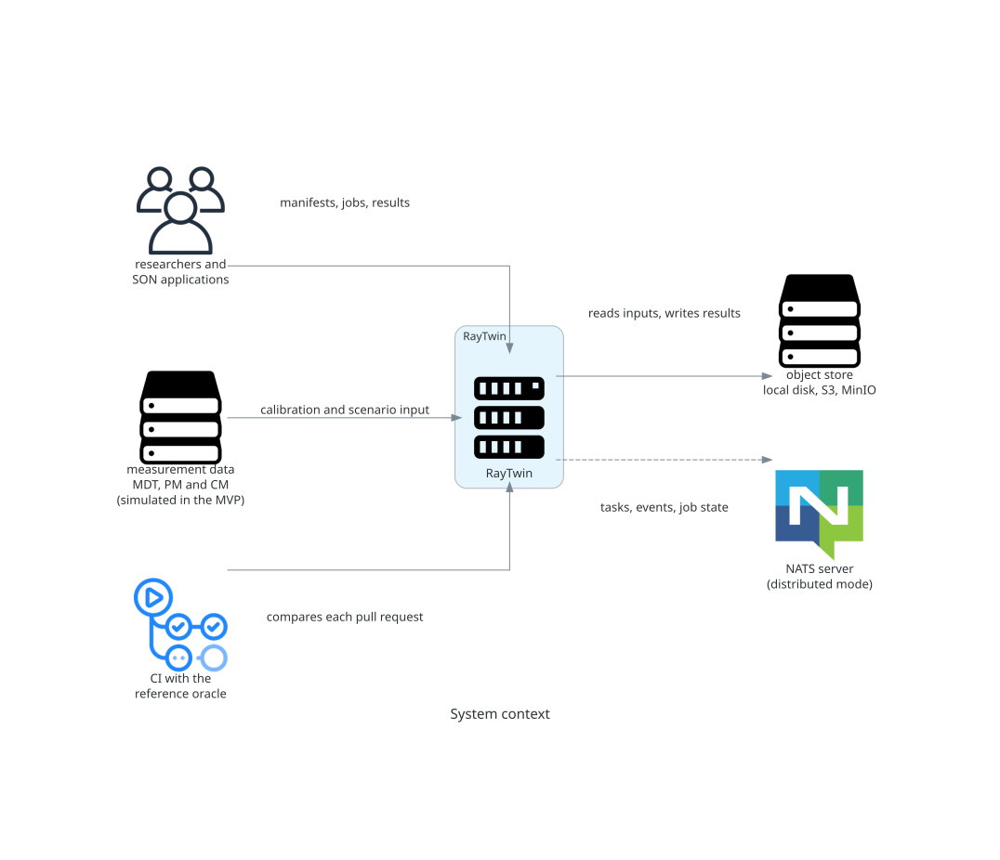

The script [`context.py`](context.py) draws this picture (section 3.2).

### 5.2 The overall picture

The diagram shows distributed mode. In library mode, the Python process runs the tasks itself. It needs no NATS server and no coordinator, and local disk can replace the object store.

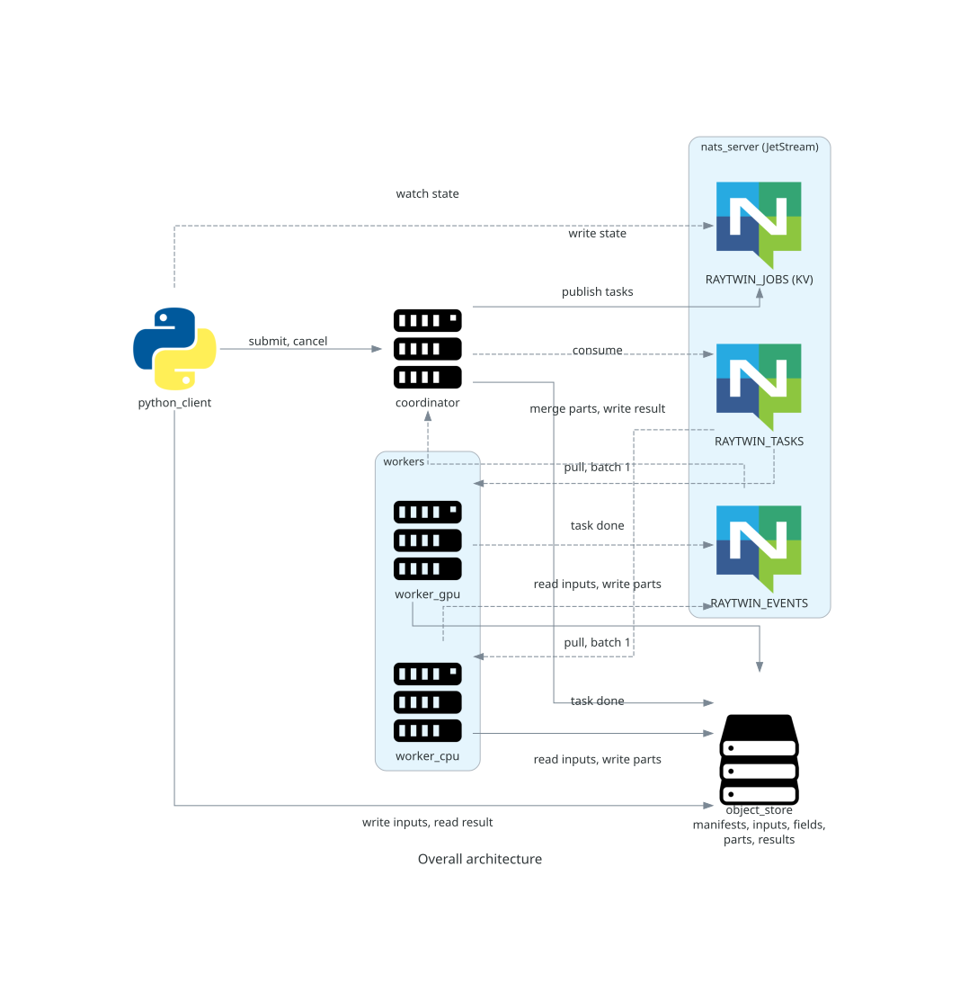

The script [`overall.py`](overall.py) draws this picture (section 3.2).

### 5.3 Element catalog

| Element | Responsibility | Owner |
|---|---|---|
| python_client | Builds manifests and RAN configs, submits jobs and reads results. In library mode it also runs the tasks. From release 0.2 it runs the service-quality layer and the plugins | RayTwin project |
| plugin packages | Release 0.2. Python distributions that register entry points in the plugin groups. They run only in python_client | Plugin authors |
| coordinator | Checks and plans jobs, tracks completion, merges parts, and writes the result and the job state | RayTwin project |
| worker | Runs one task at a time on its backend, writes the part and reports completion | RayTwin project |
| nats_server | Holds the task queue, the completion events and the job state. Routes the client requests | Deployment operator |
| object_store | Holds the manifests, the inputs, the material fields, the parts and the results | Deployment operator |

### 5.4 External dependencies

| Dependency | Purpose | Criticality | Owner | Failure behavior |
|---|---|---|---|---|
| NATS server with JetStream | Task queue, events, job state and client protocol | Critical in distributed mode. Library mode does not use it | NATS project | Clients get "no responders" at once. The coordinator and the workers connect again with backoff. Queued tasks survive a restart, because the streams use file storage |
| Object store (S3, MinIO or local disk) | Inputs, manifests, fields, parts and results | Critical | Deployment operator | A failed read or write makes the worker send `nak` with a delay. After 5 deliveries the job fails |
| `wgpu` (pinned) and the GPU driver | GPU backends | Degraded | gfx-rs project, GPU vendor | `auto` selects the next backend and logs the reason. The CPU backend stays available |
| `obvhs`, `rayon` | BVH and parallel loops on the CPU | Critical | Crate maintainers | Build-time dependency. A panic fails only the current task |
| `zarrs`, `object_store` | Zarr arrays and object-store access | Critical | Crate maintainers, Apache Arrow | Build-time dependency. I/O errors behave as for the object store |
| `async-nats` | NATS client in the coordinator, the worker and the Python client | Critical in distributed mode | NATS project | As for the NATS server |
| PyO3, maturin, `rust-numpy` | Python binding, wheels and arrays without a copy | Degraded. The Rust API stays available | PyO3 project | Build-time dependency |
| PyTorch | Calibration loop | Degraded. Calibration is not available | PyTorch Foundation | An import of `raytwin.calib` reports the missing extra `raytwin[calib]` |
| pyarrow | MDT input in Parquet | Degraded. MDT input, calibration and MDT scenarios are not available | Apache Arrow | An import of `raytwin.mdt` reports the missing extra `raytwin[mdt]` |
| trimesh | 3D preview and glTF export | Optional. Only the viewer is not available | trimesh maintainers | An import of `raytwin.viz` reports the missing extra `raytwin[viz]` |
| Plugin packages | Release 0.2. Readers, policies, KPIs and exporters | Optional. The built-in plugins stay available | Plugin authors | A plugin with an unsupported API version, or that fails the conformance check, is not loaded. The log gives the reason |
| Reference oracle (Sionna RT 2.2.0, pinned) | Reference results in CI and simulated MDT | Optional at run time. Critical for CI | NVIDIA | On a cache miss, CI runs the oracle. If the oracle cannot run, the comparison job fails and blocks the merge |

## 6. Module view

This view shows the source code. It answers where a change goes and which module may depend on which. It says nothing about processes. Two modules of this view can run in one process, and one module can run in three processes.

### 6.1 Decomposition

The repository has this planned layout:

| Path | Content |
|---|---|
| `crates/raytwin-core/` | Physics, backends, task planning and merge |
| `crates/raytwin-store/` | Manifests, hashes, scene parser and Zarr I/O |
| `crates/raytwin-dist/` | Coordinator, worker, client protocol and the binary `raytwin` |
| `crates/raytwin-py/` | PyO3 module `raytwin._native` and the Python package in `python/raytwin/` |
| `schemas/` | Published JSON Schemas: `raytwin.manifest/v1`, `raytwin.ran/v1`, `raytwin.job/v1`, and from release 0.2 `raytwin.delta/v1` and the scenario schema |
| `tools/oracle/`, `tools/mdtgen/` | Python tools for CI and for the twin experiment. Not shipped |
| `deploy/` | `compose.yaml` and `nats.conf` for distributed mode |

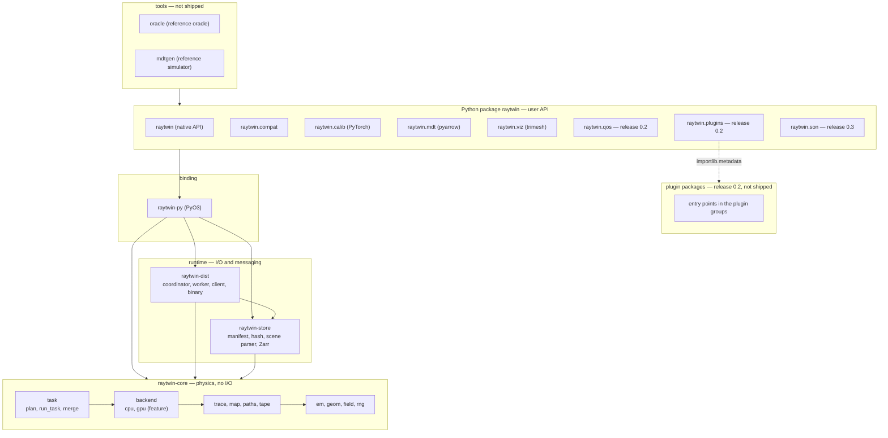

### 6.2 Allowed-to-use rules

1. `raytwin-core` imports no other RayTwin crate. It has no network, filesystem, async-runtime or Python dependency ([ADR 0001](adr/0001-one-core-two-runtime-modes.md)).
2. Inside `raytwin-core`, only the module `backend::gpu` imports `wgpu`. The cargo feature `gpu` enables that module.
3. `raytwin-store` imports only `raytwin-core` from RayTwin. It never imports `raytwin-dist` or `raytwin-py`.
4. `raytwin-dist` imports only `raytwin-core` and `raytwin-store` from RayTwin. It never imports `raytwin-py`.
5. `raytwin-py` can import every RayTwin crate. The Python package `raytwin` never imports the reference oracle. Only `raytwin.calib` imports `torch`. Only `raytwin.mdt` imports `pyarrow`. Only `raytwin.viz` imports `trimesh`. `raytwin.qos` and `raytwin.son` import only `numpy` and RayTwin modules.
6. Inside `raytwin-core`, a module imports only modules of its own layer or of a lower layer. The layers, from high to low, are `task`, then `backend`, then `trace`, `map`, `paths` and `tape`, then `em`, `geom`, `field` and `rng`.
7. Only `tools/` imports the reference oracle.
8. The PyTorch intensity model in `raytwin.calib` agrees with `raytwin-core::em` ([D-08](#10-decisions-and-rationale)).
9. From release 0.2, Python modules load plugin code only through `raytwin.plugins`. No Rust crate loads plugin code. A table plugin enters only as a snapshot input ([ADR 0004](adr/0004-plugin-api.md)).

**Enforced by.**

- Rules 1, 3 and 4: `cargo deny check` in CI. A `[bans] deny` entry with `wrappers` names the RayTwin crates that can depend directly on `tokio`, `object_store`, `async-nats`, `zarrs`, `pyo3` and `wgpu`. A forbidden edge fails the build. Cargo itself rejects dependency cycles.
- Rules 5 and 7: the wheel smoke test runs in an environment without the reference oracle, PyTorch, pyarrow and trimesh. It imports `raytwin`, `raytwin.compat` and, from release 0.2, `raytwin.qos`. A forbidden import fails the test.
- Rule 8: the parity test in CI. With δ = 0, PyTorch and Rust agree within 10⁻⁶.
- Rule 9: a test lists the calls of `importlib.metadata.entry_points` in the package. Only `raytwin.plugins` may contain one.
- Rules 2 and 6: review only. See section 12.

### 6.3 Element catalog

| Module | Responsibility | Source |
|---|---|---|
| `raytwin-core` | Geometry, BVH, SBR, image method, materials, antennas, voxel and plane accumulation, CIR, tapes, backends, task planning and merge | `crates/raytwin-core/` (planned) |
| `raytwin-store` | Manifests, canonical hashes, hash checks, create-only writes, Mitsuba XML and PLY parser, Zarr read and write, worker cache | `crates/raytwin-store/` (planned) |
| `raytwin-dist` | Coordinator, worker, NATS job protocol, and the binary `raytwin` with the subcommands `coordinator` and `worker` | `crates/raytwin-dist/` (planned) |
| `raytwin-py` | PyO3 module `raytwin._native`. Gives arrays to Python without a copy. Releases the GIL during calculation | `crates/raytwin-py/` (planned) |
| `raytwin` (Python) | Native API, `raytwin.compat`, `raytwin.calib`, `raytwin.mdt` and `raytwin.viz`. From release 0.2 also `raytwin.qos` and `raytwin.plugins`. From release 0.3 also `raytwin.son` | `crates/raytwin-py/python/raytwin/` (planned) |
| `schemas` | Published JSON Schemas of the documents that clients write | `schemas/` (planned) |
| `tools/oracle` | Runs the pinned reference oracle, caches its results, compares RayTwin results and writes the CI report | `tools/oracle/` (planned) |
| `tools/mdtgen` | Generates simulated MDT with the reference simulator for the twin experiment | `tools/mdtgen/` (planned) |
| `deploy` | Docker Compose file and NATS configuration for distributed mode | `deploy/` (planned) |

### 6.4 `raytwin-core`

**Purpose.** `raytwin-core` holds all the physics and the task logic that both runtime modes share (F-03, F-04, F-05, F-07, [ADR 0001](adr/0001-one-core-two-runtime-modes.md)).

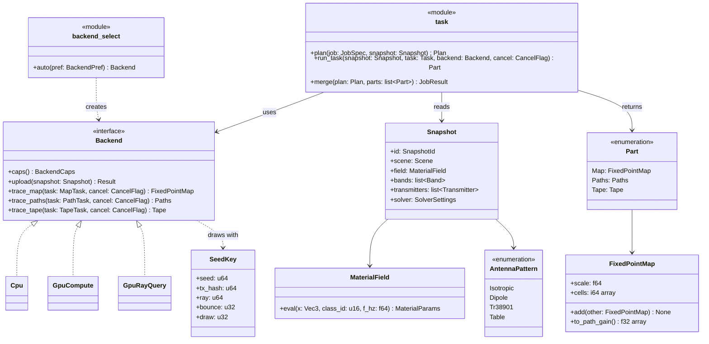

**Key types.**

| Type | Kind | Note |
|---|---|---|
| `task` | module | The seam that both modes share. `plan` splits a job into tasks and fixes the scale s of each transmitter. From release 0.3 it skips each transmitter whose result exists. `run_task` traces one task. `merge` adds map parts of one transmitter in any order and joins path and tape parts in task order |
| `Backend` | interface | Internal trait with three implementations. It is not a public API ([ADR 0004](adr/0004-plugin-api.md)). Each implementation gives bit-identical results between runs |
| `backend_select` | module | Tries `GpuRayQuery`, then `GpuCompute`, then `Cpu`. Logs why it skips a backend ([D-07](#10-decisions-and-rationale)) |
| `FixedPointMap` | class | 64-bit integer accumulator per band and voxel, with the scale s of its transmitter, and a 32-bit segment count per voxel. `add` is an integer addition |
| `SeedKey` | class | Philox key and counter. It contains no job id and no batch index ([ADR 0003](adr/0003-deterministic-monte-carlo-with-fixed-point-accumulation.md)) |
| `MaterialField` | class | Prior per class plus the δ grid with trilinear interpolation. The prior comes from the ITU parameters, or from release 0.3 from a material table in the snapshot (PL-09). It is a struct, not a trait |
| `AntennaPattern` | enumeration | Isotropic, dipole and TR 38.901. From release 0.3, `Table`: a gain table on a (θ, φ) grid from the snapshot (PL-08). CPU and GPU interpolate it with the same rule |
| `CancelFlag` | class | Shared flag. The backend reads it between two sub-batches of rays |

**Why the core has no queue.** Library mode runs the tasks of a plan with a parallel iteration in the calling process. Distributed mode gets the same tasks from JetStream. Thus `run_task` and `merge` are the only shared seam ([ADR 0001](adr/0001-one-core-two-runtime-modes.md)).

**Why `Backend` has `trace_tape`.** Calibration tapes run in both modes (F-06). A tape trace is a path trace that also keeps 8 grid indices and 8 trilinear weights per hit ([D-08](#10-decisions-and-rationale)).

**Determinism.** Ray directions come from the Fibonacci lattice. Random numbers come from Philox with `SeedKey`. Russian roulette ignores the transmitter antenna gain. Every backend accumulates with 64-bit integers. The CPU backend and the compute shader use the same watertight ray–triangle test (QA-03, QA-04).

**Independent transmitters.** The seed key, the scale s and the accumulator of a transmitter depend only on the trace inputs of that transmitter and on the shared scene, field, bands, solver settings and grid. A change of another transmitter leaves its result bit-identical. The transmitter cache of release 0.3 uses this rule (QA-15, [ADR 0003](adr/0003-deterministic-monte-carlo-with-fixed-point-accumulation.md)).

**Cancellation inside a task.** A task splits its ray range into sub-batches. The backend reads `CancelFlag` between two sub-batches. The worker sets the flag when the job state becomes `cancelled` (QA-11).

**Maps hold path gain, not RSRP.** A map holds path gain for 1 W of transmit power, with the transmitter antenna pattern. RSRP and SINR come from the RAN config when a reader asks for them: the reference-signal EPRE, the UE gain and body loss, and the noise figure. A change of the RAN config then needs no new trace (QA-04, [D-14](#10-decisions-and-rationale), [D-15](#10-decisions-and-rationale)).

**Memory on a small GPU.** The backend selects the batch size and the receiver count per pass from the free VRAM (QA-07).

**What is absent.** The core does not contain these items:

- a 32-bit emulation of 64-bit atomics ([D-07](#10-decisions-and-rationale))
- plugin code of any kind. Plugins act only through tables in the snapshot ([ADR 0004](adr/0004-plugin-api.md))
- diffraction and diffuse scattering, which come after the MVP (TR §14.1). They will be part of the core, not plugins
- service-quality models. They are in the Python package ([ADR 0001](adr/0001-one-core-two-runtime-modes.md))

### 6.5 `raytwin-store`

**Purpose.** `raytwin-store` reads and writes all persistent data. It makes sure that RayTwin reads exactly what the manifest names (F-01, F-02, [ADR 0002](adr/0002-snapshot-identity-and-path-based-storage.md), [D-09](#10-decisions-and-rationale)).

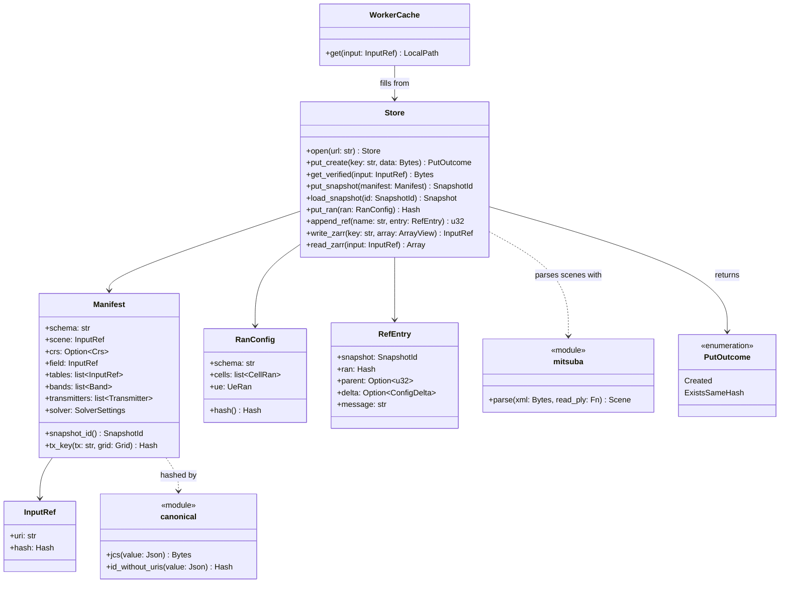

**Key types.**

| Type | Kind | Note |
|---|---|---|
| `Store` | class | One API for local disk, S3 and MinIO through `object_store`. Every write is create-only. A write that finds the same hash returns `ExistsSameHash`. A write that finds another hash is an error |
| `Manifest` | class | All inputs of a ray trace, including the solver settings and the seed. Each input is an `InputRef`. `crs` is an EPSG code and the origin of the scene coordinates. `tables` holds the pattern and material tables of release 0.3. `tx_key` is the canonical hash of the trace inputs of one transmitter (release 0.3) |
| `RanConfig` | class | JSON schema `raytwin.ran/v1`. Per cell and band: reference-signal EPRE, the on/off state and, from release 0.2, CIO, handover parameters and resource grid. Per UE class: antenna gain, body loss and noise figure. It has its own hash and is not part of the snapshot |
| `RefEntry` | class | One entry of a reference log. `append_ref` selects the next free sequence number with a create-only write ([ADR 0002](adr/0002-snapshot-identity-and-path-based-storage.md)) |
| `canonical` | module | RFC 8785 canonical JSON. `id_without_uris` removes every `uri` field before the BLAKE3 hash |
| `mitsuba` | module | Reads the Mitsuba XML subset of the sample scenes and the referenced PLY files. Reports each unsupported element (C-06) |
| `WorkerCache` | class | Local directory keyed by content hash. Checks the hash one time, when it stores a file. Deletion of an entry is always safe |

**Object keys.** User inputs stay under the paths that the user selects, for example `scenes/<name>/`. RayTwin writes its own objects under these keys:

| Key | Writer | Content |
|---|---|---|
| `snapshots/<snapshot-id>.json` | `put_snapshot` | Manifest with URIs |
| `ran/<hash>.json` | `put_ran` | RAN config |
| `refs/<name>/<seq>.json` | `append_ref` (release 0.2) | One entry of the history of a plan |
| `tx/<tx-key>.zarr` | merge (release 0.3) | Result of one transmitter, for reuse by later jobs |
| `fields/<name>/v<N>.zarr` | calibration commit | Material field, version N |
| `calib/<run>/iter-<k>.zarr` | calibration loop | δ for the trace at iteration k |
| `jobs/<job-id>/spec.json` | coordinator | Canonical job spec |
| `jobs/<job-id>/parts/<task>.zarr` | worker | Part of one task |
| `jobs/<job-id>/result.zarr` | coordinator, or library mode | Merged result |
| `jobs/<job-id>/result.json` | coordinator, or library mode | Result manifest: job id, snapshot id, part hashes and result hash |
| `qos/<run-id>.zarr` | `raytwin.qos` (release 0.2) | Service-quality time series of one run. The run id is the hash of the job id, the RAN config hash, the scenario and the plugin identities |

**Zarr arrays.** All results use Zarr v3 ([D-09](#10-decisions-and-rationale)). Every result array has these attributes: `grid.origin`, `grid.cell`, `grid.shape`, `axes`, `bands`, `tx_ids`, `crs`, `snapshot_id` and `job_id`. A reader, a viewer or a later UI needs nothing else to place the values in space.

| Result | Array | Shape | Type |
|---|---|---|---|
| Radio map | `path_gain` | `[band, tx, z, y, x]` | f32 |
| Radio map | `segments` | `[tx, z, y, x]` | u32 |
| Measurement plane | `path_gain`, `segments` | `[band, tx, y, x]`, `[tx, y, x]` | f32, u32 |
| Map part | `q` with the attribute `scale`, and `segments` | `[band, z, y, x]` and `[z, y, x]` for one transmitter | i64, u32 |
| CIR | `a` | `[rx, rx_ant, tx, tx_ant, path, band]` | complex64 |
| CIR | `tau`, `valid` | `[rx, rx_ant, tx, tx_ant, path]` | f64, bool |
| Path metadata | `interactions`, `primitives`, `vertices` | `[rx, tx, path, depth]`, with a last axis of 3 for `vertices` | u8, u32, f32 |
| Tape | hit arrays and `valid` | `[sample, path, hit]` | f32, u32, bool |
| Material field | `delta_eps`, `delta_sigma` | `[z, y, x]` | f32 |

**Field versions and reference entries.** The calibration commit selects the next free number N. If two writers select the same N, the second writer gets an error for a different hash and tries N + 1. `append_ref` uses the same rule for the sequence number of a reference entry.

### 6.6 `raytwin-dist`

**Purpose.** `raytwin-dist` runs distributed mode. It contains the coordinator, the worker and the client side of the NATS job protocol (F-08, [D-05](#10-decisions-and-rationale), [D-06](#10-decisions-and-rationale)).

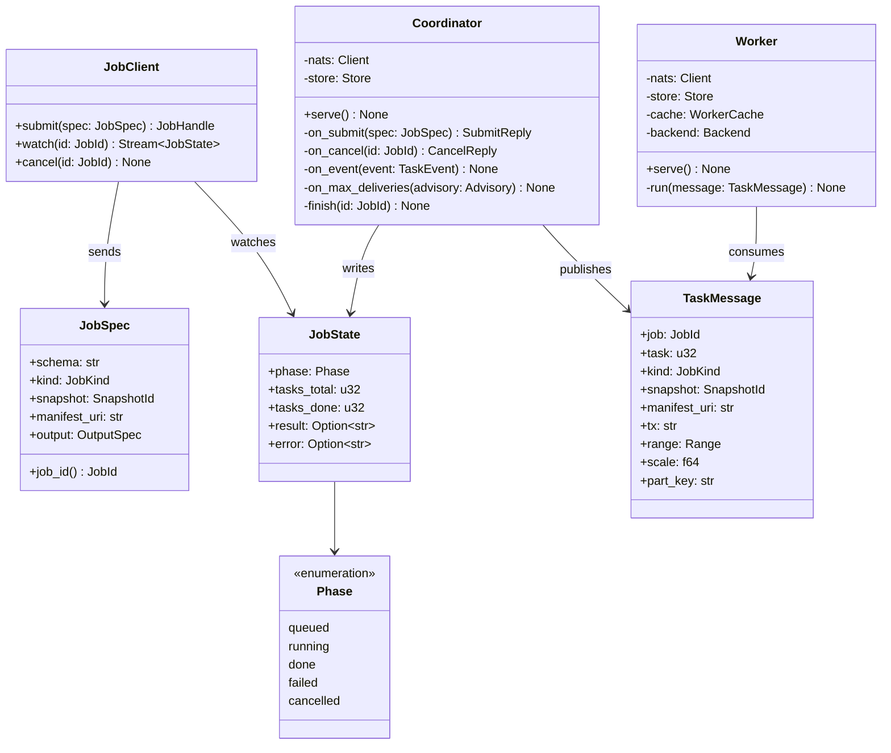

**Key types.**

| Type | Kind | Note |
|---|---|---|
| `JobSpec` | class | JSON schema `raytwin.job/v1`. Holds the job kind, the snapshot and the output geometry: voxel grid, receiver points or measurement samples. The seed is in the manifest, not here |
| `JobState` | class | Value of `job.<id>` in the KV bucket `RAYTWIN_JOBS`. Only the coordinator writes it |
| `TaskMessage` | class | References only. Each message is far below the 1 MB limit (C-08) |
| `Coordinator` | class | Has no state of its own. It keeps the job state in KV and the specs, parts and results in the object store |
| `Worker` | class | Runs one task at a time. The calculation runs on a blocking thread, and the acknowledgement timer runs on the async runtime |

**NATS names.**

| Name | Type | Use |
|---|---|---|
| `raytwin.jobs.submit` | Request and reply subject | Job submission (C1) |
| `raytwin.jobs.cancel` | Request and reply subject | Job cancellation (C2) |
| `RAYTWIN_TASKS`, subjects `raytwin.tasks.<job>.<task>` | Stream, WorkQueue retention, file storage | Task queue with the durable pull consumer `workers` |
| `RAYTWIN_EVENTS`, subjects `raytwin.events.<job>` | Stream, limits retention, file storage | Completion and failure events with the durable consumer `coordinator` |
| `RAYTWIN_JOBS`, keys `job.<id>` | KV bucket | Job state |
| `$JS.EVENT.ADVISORY.CONSUMER.MAX_DELIVERIES.RAYTWIN_TASKS.workers` | Advisory subject | Tasks that reached `MaxDeliver` |

**Restart of the coordinator.** On start, the coordinator reads every KV entry in the phase `queued` or `running`, and the spec of each one. It publishes the tasks of `queued` jobs again with the same message ids. JetStream delivers again each event that the coordinator did not acknowledge.

**Merge after the last part.** The coordinator counts completion events in KV. When `tasks_done` equals `tasks_total`, it reads all parts from the object store and merges them. A restart therefore loses no merge state.

**Transmitter cache (release 0.3).** Before it publishes tasks, the planner calculates `tx_key` for each transmitter of a radio-map job. If `tx/<tx-key>.zarr` exists, the job publishes no task for that transmitter, and the merge copies the cached array into the result. After a merge, the coordinator writes the array of each traced transmitter to `tx/<tx-key>.zarr`, create-only. Library mode uses the same rule (QA-15, [D-13](#10-decisions-and-rationale)).

**Checks at the trust boundary.** The coordinator checks each request against the JSON schema. It also reads the manifest and checks that its id equals the snapshot id of the request. A worker checks the hash of each input again when it caches the input.

**Panics.** The worker catches a panic in `run_task`. Before the last delivery it sends `nak` with a delay. On the last delivery it publishes a failure event and sends `term`. The max-deliveries advisory covers a worker process that stops on its last delivery.

### 6.7 `raytwin` (Python package)

**Purpose.** The package gives the Python API for both modes, the Sionna-compatible layer, the calibration loop, the MDT input and the 3D viewer (F-06, F-09, F-13, [D-06](#10-decisions-and-rationale), [D-08](#10-decisions-and-rationale), [D-12](#10-decisions-and-rationale), [D-16](#10-decisions-and-rationale)). Section 6.8 gives the modules of releases 0.2 and 0.3.

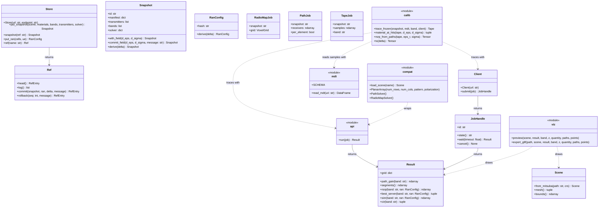

**Key types.**

| Type | Kind | Note |
|---|---|---|
| `api.run` | function | Library mode. Runs the job in the calling process and releases the GIL during the calculation |
| `Client`, `JobHandle` | class | Distributed mode. `Client("nats://…")` wraps `async-nats` from `raytwin-py`. `cancel` sends C2 |
| `Scene` | class | `mesh` returns the vertices, the triangles, the class id of each triangle and the class names as NumPy arrays. `bounds` returns the bounding box. `crs` is optional |
| `Snapshot` | class | `manifest`, `transmitters`, `bands` and `solver` read the configuration. `derive` (release 0.2) applies a config delta and puts a new snapshot |
| `RanConfig` | class | Radio parameters that act at read time. `derive` (release 0.2) applies a config delta |
| `Ref` | class | Release 0.2. The history of a plan. `rollback` appends an entry that points to an earlier pair. Nothing is deleted ([ADR 0002](adr/0002-snapshot-identity-and-path-based-storage.md)) |
| `Result` | class | Reads the Zarr result and its grid attributes. `rsrp` gives `[tx, z, y, x]` through the measurement operator of the RAN config. `best_server` gives the serving cell and its RSRP. `sinr` adds only cells on the same carrier. `segments` marks the ray-sufficient cells |
| `mdt` | module | Needs the extra `raytwin[mdt]`. The canonical MDT schema and `read_mdt`. Coordinates are scene coordinates; longitude and latitude are optional columns |
| `viz` | module | Needs the extra `raytwin[viz]`. `preview` shows the scene, a map slice at height z, paths and points inline in Jupyter with three.js. Cells with fewer than 100 segments are transparent. `export_gltf` writes the same content to a `.glb` file. Release 0.2 adds users, serving cells, cell load and handover events for one time step |
| `calib` | module | Needs the extra `raytwin[calib]`. `trace_frozen` runs in library mode when `client` is `None`, and submits a `TapeJob` when it is a `Client`. The loss compares reported RSRP from the measurement operator with the MDT value ([D-14](#10-decisions-and-rationale)) |
| `compat` | module | Sionna-compatible names for CI and examples only |

**Two copies of the intensity model.** `calib.rsrp_from_paths` repeats the Fresnel and thin-slab formulas of `raytwin-core::em` in PyTorch. The parity test keeps them in agreement ([D-08](#10-decisions-and-rationale)).

**Tapes without a copy.** In library mode, the tape arrays are NumPy views on Rust memory, and `torch.from_numpy` uses them directly. In distributed mode, `trace_frozen` reads the tape parts from Zarr into NumPy one time.

**Scope of `compat`.** It covers `load_scene`, `PlanarArray`, `Transmitter`, `Receiver`, `PathSolver`, `RadioMapSolver` and `cir(out_type="numpy")`. A change of the reference API changes only this module (TR §10.5).

### 6.8 `raytwin.qos`, `raytwin.plugins` and `raytwin.son` (releases 0.2 and 0.3)

**Purpose.** These modules simulate service quality on radio-map results, load plugins, and run SON loops (F-14 to F-18, [ADR 0004](adr/0004-plugin-api.md), [D-11](#10-decisions-and-rationale), [D-13](#10-decisions-and-rationale)). They run in the client process and use only NumPy and RayTwin modules.

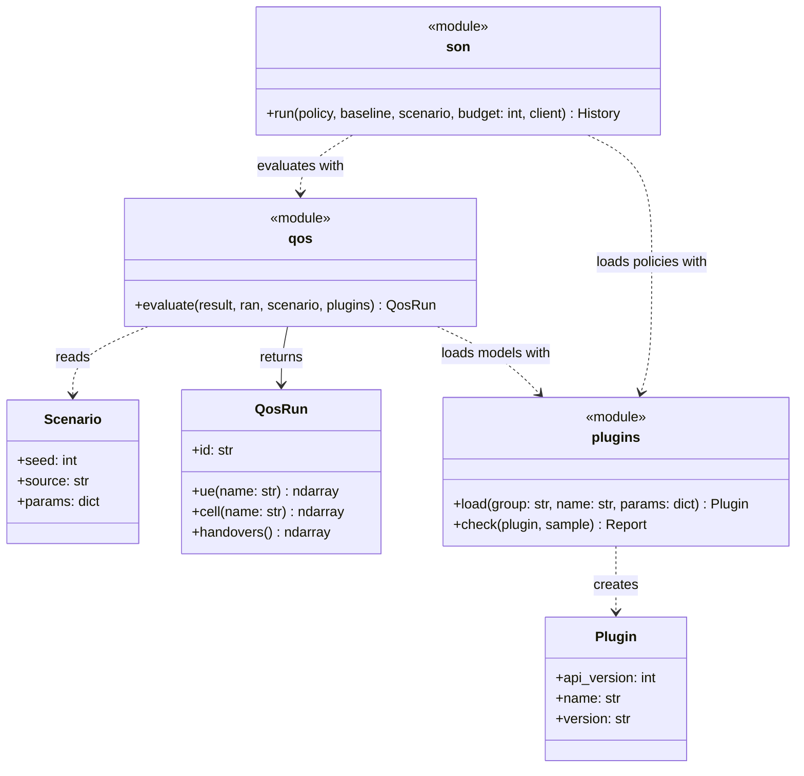

**Key types.**

| Type | Kind | Note |
|---|---|---|
| `qos.evaluate` | function | Release 0.2. Samples the radio map at the user positions, selects the serving cells, solves the cell loads as a fixed point, maps SINR to rate, shares the resources, and runs the handover model along the trajectories. It writes `qos/<run-id>.zarr` |
| `Scenario` | class | Release 0.2. Seed, source (MDT, density, waypoints) and parameters. Its generator key is (scenario seed, model id), so it contains no network configuration ([ADR 0003](adr/0003-deterministic-monte-carlo-with-fixed-point-accumulation.md)) |
| `QosRun` | class | Release 0.2. Reads the time series of one run. A static scenario has one time step |
| `plugins.load` | function | Release 0.2. Finds the entry point in the group, checks `api_version`, and returns the plugin with its identity for the run id |
| `plugins.check` | function | Release 0.2. Conformance check: two runs and one run with permuted input rows must give bit-identical output (QA-14) |
| `son.run` | function | Release 0.3. Asks the policy for candidate deltas, derives the candidates, submits radio-map jobs only for changed transmitters, evaluates each candidate on the same scenario, and stops at the budget. At the end it evaluates the best candidates again with another seed |

**Plugin groups.**

| # | Group | Built-in plugins | Release |
|---|---|---|---|
| PL-01 | `raytwin.mdt_readers` | Canonical Parquet | 0.2 |
| PL-02 | `raytwin.qos.association` | Highest RSRP plus CIO | 0.2 |
| PL-03 | `raytwin.qos.link` | Truncated Shannon with overhead | 0.2 |
| PL-04 | `raytwin.qos.sharing` | Full buffer, processor sharing | 0.2 |
| PL-05 | `raytwin.qos.mobility` | Layer-3 filter, event A3 and time to trigger | 0.2 |
| PL-06 | `raytwin.qos.scenario` | MDT replay positions, density from MDT, waypoints | 0.2 |
| PL-07 | `raytwin.kpi`, `raytwin.exporters` | Percentiles, outage, load; Parquet export | 0.2 |
| PL-08 | `raytwin.pattern_readers` | — | 0.3 |
| PL-10 | `raytwin.scene_importers` | — | 0.3 |
| PL-11 | `raytwin.son.policies` | Grid search | 0.3 |

PL-09, the material tables, is data in the snapshot and has no group.

**Arrays of a service-quality run.** The run is a time series, so a later viewer or UI can replay it step by step.

| Array | Shape | Type |
|---|---|---|
| `ue_pos` | `[t, ue, 3]` | f32 |
| `ue_cell` | `[t, ue]` | i32, −1 for no service |
| `ue_rsrp`, `ue_sinr`, `ue_thr` | `[t, ue]` | f32 |
| `cell_load`, `cell_ues` | `[t, cell]` | f32, u32 |
| `handovers` | `[event]` with fields `t`, `ue`, `src`, `dst`, `kind` | structured |

The attributes are `ue_ids`, `cell_ids`, `t0`, `dt`, the scenario seed and the plugin identities. A cell id is the pair (transmitter, band). A user id is the sample index, or the pseudonymous MDT trace id.

## 7. Component-and-connector view

This view shows what exists while the system runs. Every box has a lifetime: it starts, it can fail, and something can start it again. Every line is a connector with a protocol and a failure behavior.

### 7.1 Runtime structure

Distributed mode:

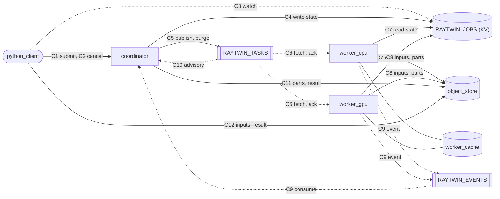

Library mode:

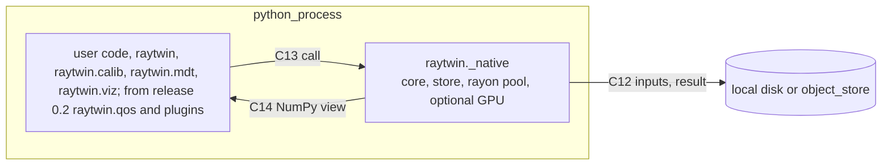

### 7.2 Connector catalog

| # | From → To | Type | Protocol | Carries | Timeout and retry | Failure behavior |
|---|---|---|---|---|---|---|
| C1 | python_client → coordinator | Synchronous | NATS request and reply on `raytwin.jobs.submit`, JSON | Job spec. The reply is the job id and the state | Client timeout 10 s. A retry is safe, because the job id comes from the spec | No responders: the client reports at once that no coordinator runs. Timeout: the client sends the request again, or reads the state through C3 |
| C2 | python_client → coordinator | Synchronous | NATS request and reply on `raytwin.jobs.cancel`, JSON | Job id | Client timeout 10 s. A retry is safe | No responders or timeout: the job continues, and the client reports that the cancel failed |
| C3 | python_client → RAYTWIN_JOBS | Asynchronous | JetStream KV watch | Changes of the job state | The client library connects again. The watch then gives the latest value | The client sees an old state until it connects again. No state is lost |
| C4 | coordinator → RAYTWIN_JOBS | Synchronous | KV update with the expected revision | Job state | Retry with backoff after a broker error | If the update fails, the coordinator does not acknowledge the event that caused it. JetStream delivers that event again |
| C5 | coordinator → RAYTWIN_TASKS | Synchronous | JetStream publish with server acknowledgement, message id `<job>.<task>`. Purge by subject | Task messages | Retry until the server acknowledges. The server drops a duplicate inside its deduplication window | If publication stops halfway, the job stays `queued`. After a restart the coordinator publishes again. A duplicate task writes the same part, and the coordinator ignores its second event |
| C6 | RAYTWIN_TASKS → worker | Asynchronous | JetStream pull consumer `workers`, batch 1 | One task message | `AckWait` 30 s. In-progress every 10 s. `MaxDeliver` 5. `nak` with a delay after a transient error | A stopped worker sends no acknowledgement. After `AckWait`, JetStream gives the task to another worker, which writes the same part |
| C7 | worker → RAYTWIN_JOBS | Synchronous | KV get | State of the job of the current task | At task start and at each in-progress tick. No retry inside a tick | If the read fails, the worker continues the task. A cancel then has effect one tick later |
| C8 | worker → object_store | Synchronous | S3 API over HTTP, or local filesystem | Inputs, checked by hash. Parts, written create-only | Default retry policy of `object_store`, with backoff | Read failure: `nak` with a delay. Hash mismatch: failure event and `term`. `AlreadyExists` with the same hash counts as success |
| C9 | worker → RAYTWIN_EVENTS → coordinator | Asynchronous | JetStream publish with message id `<job>.<task>`. Durable consumer `coordinator` | Completion event with part key and part hash, or failure event with the reason | At least once. The coordinator acknowledges an event after C4 succeeds | Duplicate events: ignored by job and task. Events of a cancelled or finished job: acknowledged and ignored |
| C10 | nats_server → coordinator | Asynchronous | Core NATS subscription to the max-deliveries advisory | Stream sequence of a task that reached `MaxDeliver` | The server does not keep advisories. A coordinator that is down misses them | The coordinator marks the job `failed` and purges its tasks. A missed advisory leaves the job `running` (section 12) |
| C11 | coordinator → object_store | Synchronous | S3 API over HTTP, or local filesystem | Reads specs, manifests and parts. Writes the result and the result manifest, create-only | Default retry policy of `object_store`, then a merge retry with backoff | The job stays `running` with all tasks done. After a restart the coordinator merges again from the parts |
| C12 | python_client → object_store | Synchronous | S3 API over HTTP, or local filesystem, through `raytwin-store` | Writes inputs and manifests. Reads results | Default retry policy of `object_store` | The Python call raises an error. No incomplete snapshot exists, because `put_snapshot` writes the manifest last |
| C13 | Python → `raytwin._native` | Synchronous | PyO3 call in one process. The call releases the GIL | Snapshots, jobs and results | None | A Rust error becomes a Python exception. A panic becomes `PanicException`, and the process continues |
| C14 | `raytwin._native` → Python | Synchronous | NumPy arrays on Rust memory (`rust-numpy`) | Results and tapes | None | The only failure is memory exhaustion. Each array keeps its Rust buffer alive |

**Delivery guarantee.** C6 and C9 are at least once. Three rules make a second delivery safe:

1. A task gives the same part every time, because the seed key and the integer accumulation do not depend on the run ([ADR 0003](adr/0003-deterministic-monte-carlo-with-fixed-point-accumulation.md)).
2. A part write is create-only. A second write with the same hash counts as success ([ADR 0002](adr/0002-snapshot-identity-and-path-based-storage.md)).
3. The coordinator counts each (job, task) one time, and the merge reads each part key one time.

### 7.3 Component catalog

| Component | Kind | Responsibility | State it owns | Built from |
|---|---|---|---|---|
| python_client | process | Builds manifests, submits jobs and reads results. In library mode it runs the tasks | Distributed mode: none. Library mode: the running job, in memory | `raytwin`, `raytwin-py`, `raytwin-core`, `raytwin-store`, `raytwin-dist` (client part) |
| coordinator | service | Checks and plans jobs, publishes tasks, tracks completion, merges parts, and writes results and state | None of its own. The state is in `RAYTWIN_JOBS` and the object store | `raytwin-dist`, `raytwin-core`, `raytwin-store` |
| worker_cpu | worker | Runs tasks on the CPU backend | Its worker cache, which it can lose | `raytwin-dist`, `raytwin-core`, `raytwin-store` |
| worker_gpu | worker | Runs tasks on a GPU backend, with the CPU as the last choice | Its worker cache, which it can lose | `raytwin-dist`, `raytwin-core` with the feature `gpu`, `raytwin-store` |
| nats_server | broker and store | Holds `RAYTWIN_TASKS`, `RAYTWIN_EVENTS` and `RAYTWIN_JOBS`, and routes requests | Streams and KV on disk | External: NATS server |
| object_store | store | Holds inputs, manifests, fields, parts and results | All persistent data | External: MinIO, S3 or local disk |
| worker_cache | store | Holds checked inputs by content hash | Files keyed by hash. Deletion is safe | `raytwin-store` |

worker_cpu and worker_gpu are the same binary, `raytwin worker`, with a different backend.

### 7.4 Scenario — radio-map job in distributed mode

**Trigger.** A user submits a radio-map job from Python (F-03, F-08, QA-05).

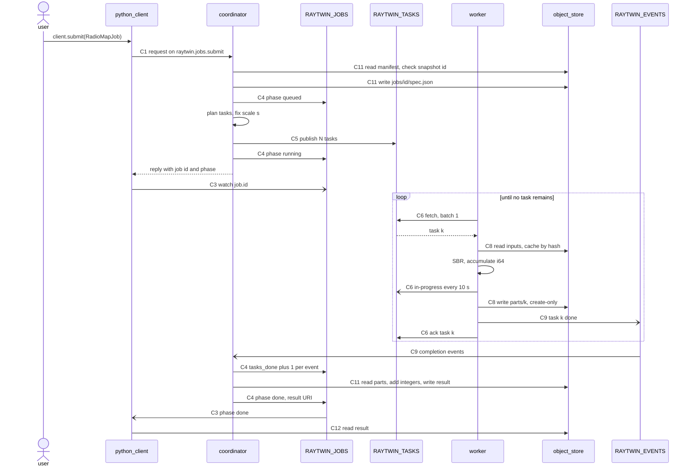

**What happens when the object store fails during the merge.** All tasks are done, but C11 fails. The job stays `running`, and the coordinator tries the merge again with backoff. The parts stay in the object store, so a coordinator restart also merges again. The user sees `running` until the merge succeeds.

### 7.5 Scenario — a worker stops during a task

**Trigger.** A worker process stops after it gets a task and before it acknowledges it (QA-06).

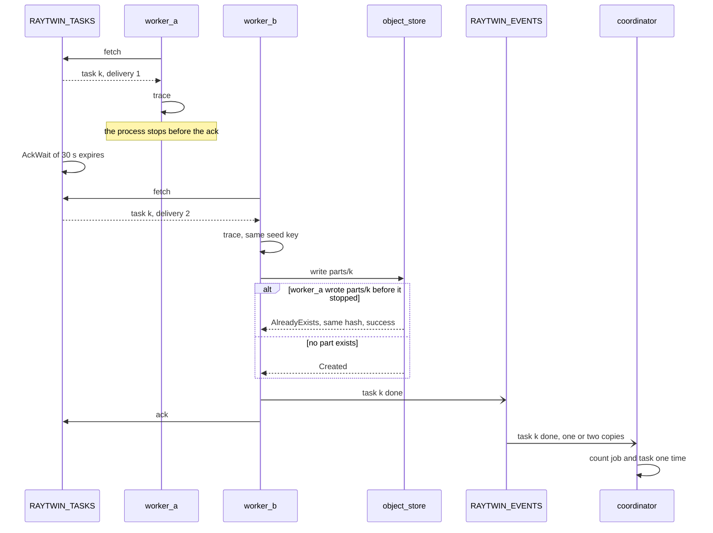

**What happens when worker_a also published its event.** The coordinator gets two events for task k. It counts the first one and ignores the second. The merge reads `parts/k` one time, so no part counts two times.

### 7.6 Scenario — a task fails permanently

**Trigger.** A task panics on every delivery, or an input does not agree with the hash in its manifest (F-02, QA-06).

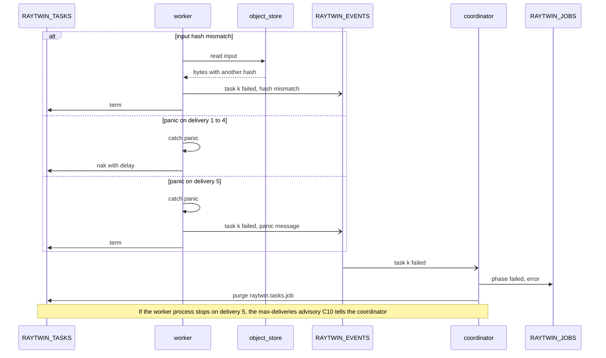

**What happens to the other tasks.** The coordinator purges the queued tasks of the failed job. Tasks that run at that moment finish or stop at the cancel check, and the coordinator ignores their events. A second submission of the same spec starts the job again ([D-06](#10-decisions-and-rationale)).

### 7.7 Scenario — calibration loop

**Trigger.** A researcher runs calibration v0 on simulated MDT in library mode (F-06, QA-09).

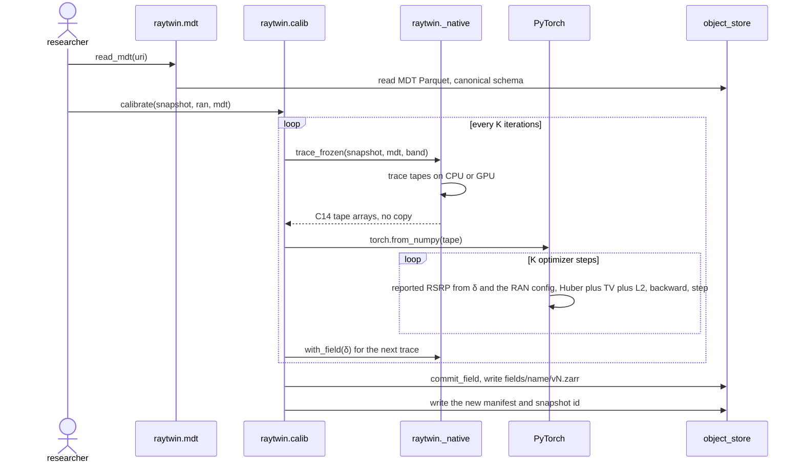

**Distributed variant.** The researcher passes a `Client` to `trace_frozen`. Before each trace, `trace_frozen` writes δ to `calib/<run>/iter-<k>.zarr` and puts a new snapshot. Then it submits a `TapeJob`, waits for it, and reads the tape parts from Zarr into NumPy.

**What happens when a tape job fails.** `trace_frozen` raises an error. The current δ stays in memory. The researcher can commit it, or submit the tape job again.

### 7.8 Scenario — cancellation of a running job

**Trigger.** A user cancels a running job (F-08, QA-11).

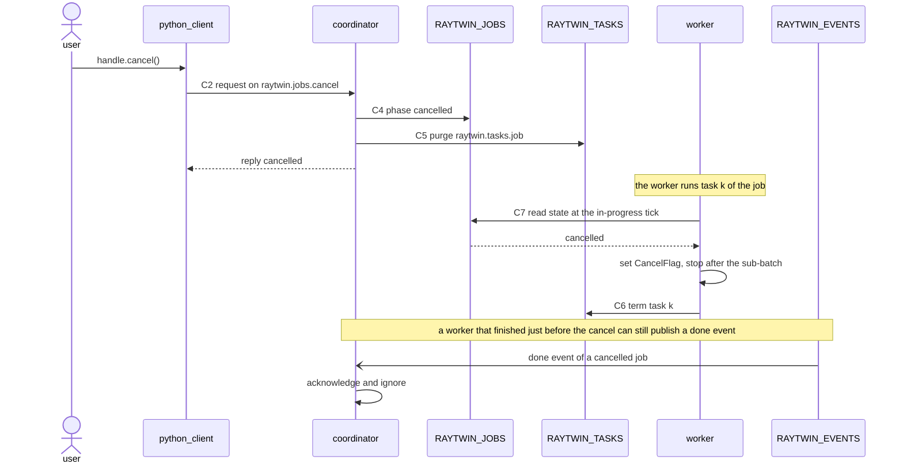

**What happens to the parts.** The parts that exist stay in the object store. A second submission of the same spec starts the job again, and the existing parts count as written ([D-06](#10-decisions-and-rationale)).

### 7.9 Scenario — service-quality what-if (release 0.2)

**Trigger.** A planner compares two cell individual offsets and one new site on the same MDT scenario (F-14, F-15, F-17, QA-12).

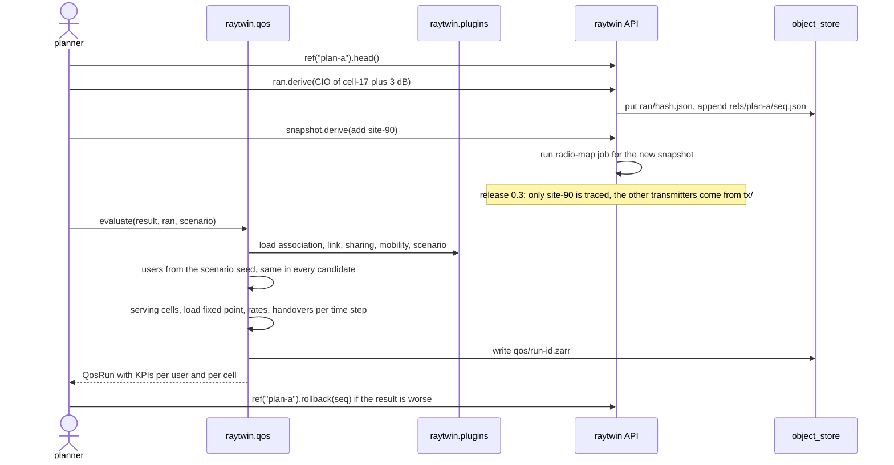

**What happens when the load has no fixed point below 1.** At least one cell needs more than all its resource blocks. `evaluate` caps the load of that cell at 1, marks the cell as overloaded, and reports the demand that it cannot serve. The run does not fail.

### 7.10 Scenario — SON loop with the transmitter cache (release 0.3)

**Trigger.** A researcher runs a SON policy that changes the tilt of three cells (F-18, QA-15).

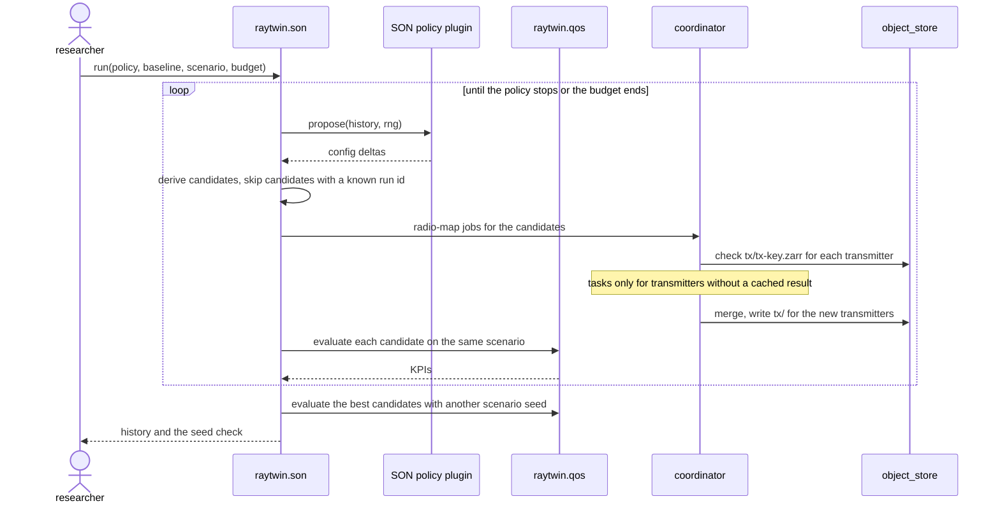

**What happens when the ranking changes with the seed.** The seed check reports the top candidates whose order changes. The researcher then increases the ray count or the scenario size before acting on the result.

## 8. Deployment view

This view allocates the components of section 7 to machines. It answers what is installed where, how many of each there are, and what scales.

### 8.1 UML deployment

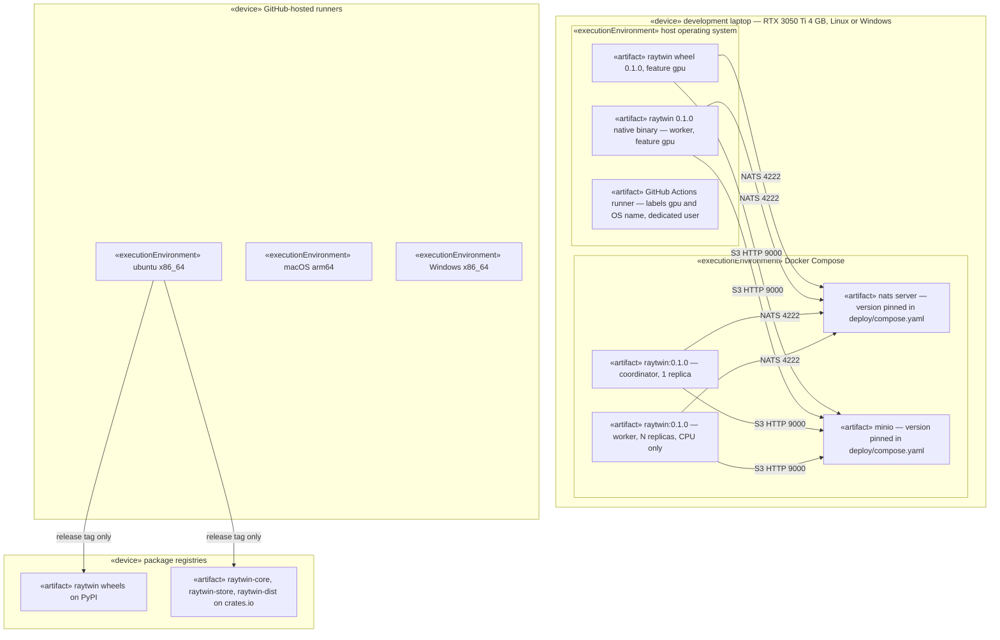

The coordinator and the workers open no listening port. NATS also listens on 8222 for monitoring, and MinIO listens on 9001 for its console. Compose publishes these ports only on `localhost`.

### 8.2 Node catalog

| Node | Environment | Sizing | Scales on | Limit |
|---|---|---|---|---|
| Development laptop | Development and GPU CI | 1 laptop. RTX 3050 Ti with 4 GB VRAM. The component-2 benchmark records the CPU core count | fixed | One operating system at a time. GPU tests for the other system wait until the owner boots it |
| Docker Compose stack | Development | 1 nats, 1 minio, 1 coordinator, N workers | `docker compose up --scale worker=N` | For Gate 2, 4T is not more than the physical core count (C-10). One NATS node, so no broker redundancy |
| GitHub-hosted runners | CI | Standard runners: ubuntu x86_64, macOS arm64, Windows x86_64 | Per job | The time limits of free runners. The component-2 benchmark gives the munich comparison time |
| Package registries | Release | PyPI, crates.io, GitHub Releases | fixed | Uploads happen only on a release tag from the owner |

### 8.3 Artifact allocation

| Artifact | Built from | Runs on | Configuration from | Secrets from |
|---|---|---|---|---|
| `raytwin` wheel 0.1.0 for Linux x86_64 and Windows x86_64, feature `gpu` | `raytwin-py`, `raytwin-core`, `raytwin-store`, `raytwin-dist` | User machines, development laptop, CI | Python arguments, `RAYTWIN_BACKEND` | Environment: standard AWS variables for S3, NATS credentials file |
| `raytwin` wheel 0.1.0 for macOS arm64, no feature `gpu` | Same modules | User machines, CI | Python arguments | Environment, as above |
| Extras `raytwin[calib]`, `raytwin[mdt]`, `raytwin[viz]` | Optional Python dependencies: PyTorch, pyarrow, trimesh | User machines, development laptop | `pip install` | None |
| Plugin packages (release 0.2) | External Python distributions with entry points | Only the Python environment of python_client. Never the coordinator or the workers | Their own `pyproject.toml` | None |
| `raytwin:0.1.0` container image, CPU only | `raytwin-dist` binary | Compose stack: coordinator and workers | Command `raytwin coordinator` or `raytwin worker`. `RAYTWIN_NATS_URL`, `RAYTWIN_STORE_URL`, `RAYTWIN_THREADS` | `.env` next to `compose.yaml`. Git ignores it |
| `raytwin` 0.1.0 native binary, feature `gpu` | `raytwin-dist` binary | Development laptop, host operating system | The same variables and `RAYTWIN_BACKEND` | The same `.env` values in the shell environment |
| Crates `raytwin-core`, `raytwin-store`, `raytwin-dist` 0.1.0 | `crates/` | crates.io | — | crates.io token in GitHub secrets, release job only |
| PyPI release of the wheels | The wheels above | PyPI | — | PyPI trusted publishing, release job only |
| nats server image | External, pinned version | Compose stack | `deploy/nats.conf`: JetStream with file storage | `.env` |
| minio image | External, pinned version | Compose stack | Compose environment | `.env` |
| GitHub Actions runner | External | Development laptop, dedicated user | Labels `gpu` and the OS name | None. The GPU workflow has no secrets ([D-10](#10-decisions-and-rationale)) |

### 8.4 Environments

| | Development | CI |
|---|---|---|
| **Differs how** | One laptop. Library mode, or the Compose stack with N CPU workers and an optional native GPU worker | GitHub-hosted runners for CPU tests, wheels and the oracle comparison. The laptop runner for GPU tests of trusted pull requests |
| **Data** | Synthetic: sample scenes of the reference oracle and simulated MDT | Synthetic: the same scenes and cached oracle results |
| **Who can deploy** | The owner | Workflows run on pull requests and on `main`. Release jobs run only on a release tag from the owner |

## 9. Mapping between views

| Module (§6) | Component (§7) | Node (§8) | Artifact |
|---|---|---|---|
| `raytwin-core` | python_client, coordinator, worker_cpu, worker_gpu | Development laptop, Compose stack, user machines, CI | Wheels, container image, native binary, crate |
| `raytwin-store` | python_client, coordinator, worker_cpu, worker_gpu, worker_cache | Development laptop, Compose stack, user machines, CI | Wheels, container image, native binary, crate |
| `raytwin-dist` | coordinator, worker_cpu, worker_gpu, python_client (client part) | Compose stack, development laptop, user machines | Container image, native binary, wheels, crate |
| `raytwin-py`, `raytwin` (Python), including `raytwin.mdt`, `raytwin.viz`, `raytwin.qos`, `raytwin.plugins` and `raytwin.son` | python_client | Development laptop, user machines, CI | Wheels and extras |
| `schemas` | python_client, coordinator (request checks) | All | Wheels, container image |
| External | plugin packages | Python environment of python_client | Plugin wheels |
| `deploy` | Configures nats_server, object_store, coordinator and worker_cpu | Compose stack | `compose.yaml`, `nats.conf` |
| External | nats_server | Compose stack | nats server image |
| External | object_store | Compose stack (MinIO), S3 or local disk | minio image |

`tools/oracle` and `tools/mdtgen` ship in no artifact. CI runs `tools/oracle` on GitHub-hosted runners, and the owner runs `tools/mdtgen` on the laptop for the twin experiment. nats_server and object_store come from no RayTwin module.

`raytwin-core` and `raytwin-store` are in four components. A change in them changes library mode, the coordinator and both worker kinds at the same time.

## 10. Decisions and rationale

The owner, Nguyễn Duy Vũ, made each decision below in the design reviews of 2026-10-29 and 2026-10-30. Rows D-11 to D-16, and the additions to D-01 to D-04, come from the review of 2026-10-30.

- Rows D-01 to D-04 have an ADR in [`adr/`](adr/README.md).
- Rows D-05 to D-16 have no ADR. The row is the record of the decision. During the design phase, a change edits the row directly.
- Rows T-01 and T-02 come from the TR decision log.
- Rows P-01 to P-08 are preferences. They are cheap to change.

| # | Decision | Answers | Alternative rejected | ADR |
|---|---|---|---|---|
| D-01 | One Rust core. Both modes call the same `run_task` and `merge`. Service quality, SON and the viewer are Python above the core | QA-03, QA-05, C-01 | Separate engines, because they double the oracle work. `TaskQueue` with `LocalQueue`, because library mode uses no queue feature | [0001](adr/0001-one-core-two-runtime-modes.md) |
| D-02 | Snapshot id from the canonical manifest without URIs. Path-based storage with hash checks and create-only writes. RAN config as a separate document. Edits as config deltas. Reference log with rollback | F-02, F-17, QA-03, QA-06 | Content-addressed blobs with references, because import must copy and unused blobs need garbage collection. Radio parameters in the manifest, because a power change would start a new trace | [0002](adr/0002-snapshot-identity-and-path-based-storage.md) |
| D-03 | Philox key without the job id. Ray paths do not depend on antenna gain. 64-bit integer accumulation in every backend and part. Scale s per transmitter. Segment counts. Scenario generator keyed without the configuration | QA-03, QA-04, QA-05, QA-12, QA-15 | Fixed-point on the GPU only, because it needs two mechanisms and an ordered merge. One scale per job, because it couples the transmitters | [0003](adr/0003-deterministic-monte-carlo-with-fixed-point-accumulation.md) |
| D-04 | No public plugin API in 0.1. From 0.2, Python entry-point plugins in the groups PL-01 to PL-07 and PL-10, PL-11. Tables (PL-08, PL-09) as snapshot inputs from 0.3. No plugin code in the Rust crates | F-16, QA-14, C-01, C-03 | Public Rust traits in 0.1. WGSL plugins, because the shader interface becomes public. Rust libraries loaded at run time, because Rust has no stable ABI. Physics plugins (PL-12), rejected by the owner | [0004](adr/0004-plugin-api.md) |
| D-05 | JetStream WorkQueue, shared pull consumer, batch 1, per-job subjects, three task kinds. In-progress acknowledgement every 10 s, `MaxDeliver` 5. Messages carry only references | F-08, QA-05, QA-06, C-08 | Push from the coordinator, because it must track workers. Ray-batch split for paths, because it needs a global deduplication | — |
| D-06 | NATS request and reply plus KV as the client protocol. Job id from the spec. Cooperative cancellation | F-08, QA-11, C-01 | gRPC with `tonic`, because it adds a second protocol stack and its own authentication | — |
| D-07 | wgpu with compute shader and ray query, selected at run time. CPU reference. No 32-bit emulation of 64-bit atomics | F-07, QA-03, QA-07, C-03 | CUDA and OptiX, because the Rust bindings are early-stage and support one vendor | — |
| D-08 | Frozen-path tapes from Rust. Intensity model in PyTorch with a parity test. Tapes in both modes | F-06, QA-09 | Rust forward model with an analytic gradient, because the complex derivatives need manual work | — |
| D-09 | Zarr for every result, including service-quality runs. Parquet only for MDT input and exports in Python | F-03, F-04, F-12, F-14 | Zarr plus Parquet, because it adds a second format and `arrow` to the Rust build | — |
| D-10 | The GPU runner runs only trusted pull requests, or a fork after the `gpu-ok` label. The runner has no secrets | QA-10, C-04 | GPU tests on every pull request, because code from forks would run on the laptop | — |
| D-11 | Service quality is a flow-level layer in Python on radio-map results: association, load-coupled SINR, truncated Shannon link model, processor sharing, layer-3 filter and A3 handover. Results are time series with stable ids, so they can be replayed. It ranks scenarios and does not predict absolute throughput | F-14, QA-12, QA-13, C-11 | A slot-level system simulator, because it needs a CIR per user and per slot and is out of scope for one person. A `qos` task kind, because one evaluation costs much less than a trace. A regression model from MDT as the main path, because it cannot answer for configurations without data | — |
| D-12 | `raytwin.mdt` from release 0.1 holds the canonical MDT schema and the reader. Columns for service quality are optional. Only pseudonymous ids | F-06, F-15, C-12 | MDT reading inside `raytwin.calib`, because service quality also reads MDT | — |
| D-13 | Transmitter cache from release 0.3: results under `tx/<tx-key>.zarr`, reused by the planner | F-18, QA-15 | Cache by job only, because a tilt change of one cell would trace every cell again | — |
| D-14 | MDT matching uses reported RSRP through a measurement operator: reference-signal EPRE, path gain, UE gain and body loss, beam consolidation, 1 dB quantization, reporting range. RSS is only a derived value | F-06, QA-09 | Total received power (RSS) as the observable, because MDT does not report it, and its conversion to RSRP adds an unknown offset per cell that calibration would put into the material field | — |
| D-15 | Radio parameters in a RAN config with its own hash. RSRP, SINR and service quality are identified by (job id, RAN config hash) | F-02, F-03, QA-04 | Radio parameters in the manifest, because a change would start a new trace | — |
| D-16 | 3D viewer `raytwin.viz` in release 0.1, through the optional extra `raytwin[viz]` (trimesh): inline preview in Jupyter and `.glb` export. No image renderer | F-13 | A viewer in a separate application, because the MVP has no UI. A path-traced image renderer, because a screenshot of the preview is sufficient | — |
| T-01 | Native Python API (Manifest → Job → Result) plus `raytwin.compat` | F-09 | Only a Sionna-compatible API, because it does not fit versioned snapshots and distributed jobs | TR Appendix A |
| T-02 | Pinned reference oracle in CI, with cached reference results | QA-01, QA-02, QA-10, C-09 | An oracle without a pinned version, because its results change between releases | TR Appendix A |
| P-01 | The GPU code is in `raytwin-core` behind the cargo feature `gpu` | F-07, F-12 | A separate GPU crate, because core internals would have to become public | — |
| P-02 | One binary `raytwin` with the subcommands `coordinator` and `worker`. One CPU-only container image. The GPU worker runs on the host | F-08 | Vulkan inside containers, because it needs the NVIDIA Container Toolkit with graphics support | — |
| P-03 | The coordinator merges parts from the object store after the last task. State only in KV and in the object store. One coordinator | QA-06 | A merge in memory, because a restart loses it. Reduce tasks on workers, because they add a task kind | — |
| P-04 | Maps hold path gain for 1 W with the transmitter pattern. RSRP and SINR at read time | QA-04 | Stored RSRP, because a power change would need a new trace | — |
| P-05 | Synchronous core with `rayon`. Asynchronous store and dist with `tokio`. Python calls block and release the GIL | QA-03, D-01 | An asynchronous core, because async in compute loops adds cost and no benefit | — |
| P-06 | The Mitsuba XML and PLY parser is in `raytwin-store` | D-01, C-06 | A parser in the core, because it needs file reads | — |
| P-07 | Solver settings and the seed are in the manifest. The job spec holds only the kind and the output geometry | QA-03, QA-04 | The seed in the job spec, because then the snapshot id does not cover all inputs | — |
| P-08 | Workers catch panics. On the last delivery they publish a failure event and send `term` | QA-06 | The advisory alone, because a coordinator that is down misses it | — |

## 11. Traceability

| Requirement | View | Elements |
|---|---|---|
| F-01 | Module | `raytwin-store` (`mitsuba`), `raytwin-core` (`Scene`) |
| F-02 | Module, C&C | `raytwin-store` (`Manifest`, `canonical`, `Store`), C8, C11, C12 |
| F-03 | Module, C&C | `raytwin-core` (`map`, `FixedPointMap`), task kind `radio_map`, scenario 7.4 |
| F-04 | Module | `raytwin-core` (`paths`), task kind `paths`, CIR arrays in section 6.5 |
| F-05 | Module | `raytwin-core` (`field`, `em`, `MaterialField`) |
| F-06 | Module, C&C | `raytwin.calib`, `Backend::trace_tape`, task kind `tape`, scenario 7.7 |
| F-07 | Module, Deployment | `backend_select`, feature `gpu`, wheels with and without `gpu` |
| F-08 | C&C, Deployment | coordinator, worker_cpu, worker_gpu, nats_server, C1 to C11, scenarios 7.4 to 7.8, Compose stack |
| F-09 | Module | `raytwin` (Python), `raytwin.compat` |
| F-10 | Module, Deployment | `tools/oracle`, GitHub-hosted runners, GPU runner |
| F-11 | Module | `tools/mdtgen` |
| F-12 | Deployment | Wheels, crates, container image, package registries |
| QA-01, QA-02 | Module, Deployment | `tools/oracle`, `raytwin-core` (`paths`, `map`), GitHub-hosted runners |
| QA-03 | Module | `SeedKey`, `FixedPointMap`, watertight intersection test |
| QA-04 | Module | `SeedKey`, the Russian-roulette rule, P-04 |
| QA-05 | C&C, Deployment | `RAYTWIN_TASKS`, worker_cpu, Compose stack, C-10 |
| QA-06 | C&C | C6, C8, C9, C10, P-08, scenarios 7.5 and 7.6 |
| QA-07 | Module | `Backend` (batch size from free VRAM) |
| QA-08 | Deployment | Wheels for three operating systems, `backend_select` |
| QA-09 | Module, C&C | `raytwin.calib`, `tools/mdtgen`, scenario 7.7 |
| QA-10 | Deployment | GitHub-hosted runners, GPU runner ([D-10](#10-decisions-and-rationale)) |
| QA-11 | C&C | C2, C5 (purge), C7, `CancelFlag`, scenario 7.8 |
| F-13 | Module | `raytwin.viz`, `Scene.mesh`, `Result` grid attributes, `segments` |
| F-14 | Module, C&C | `raytwin.qos`, plugin groups PL-02 to PL-07, `qos/<run-id>.zarr`, scenario 7.9 |
| F-15 | Module | `raytwin.mdt`, plugin groups PL-01 and PL-06 |
| F-16 | Module | `raytwin.plugins`, rule 9 of section 6.2 ([ADR 0004](adr/0004-plugin-api.md)) |
| F-17 | Module, C&C | `Snapshot.derive`, `RanConfig.derive`, `Ref`, `refs/<name>/<seq>.json`, scenario 7.9 |
| F-18 | Module, C&C | `raytwin.son`, PL-11, transmitter cache `tx/<tx-key>.zarr`, scenario 7.10 |
| QA-12 | Module | `Scenario` generator key ([ADR 0003](adr/0003-deterministic-monte-carlo-with-fixed-point-accumulation.md)) |
| QA-13 | Module | `qos.evaluate` |
| QA-14 | Module | `plugins.check` |
| QA-15 | Module, C&C | `Manifest.tx_key`, `task::plan`, transmitter cache in section 6.6 |
| Plugin API (TR §18) | Module | Release 0.1: none. Release 0.2 and 0.3: section 6.8 ([ADR 0004](adr/0004-plugin-api.md)) |

## 12. Open items

These items are outside this design, or need a decision before implementation.

1. **Second license file.** The TR names MIT OR Apache-2.0 with both license files. The repository has only the MIT file. The owner adds `LICENSE-APACHE` before release 0.1.
2. **Coordinator availability.** One coordinator runs. If it stops, jobs wait until it starts again. While it is down, it also misses max-deliveries advisories (C10). P-08 covers panics, but not a worker process that stops on its last delivery at that time. The next step is a periodic check for stuck jobs, or a second coordinator.
3. **Authentication and TLS.** The Compose stack uses a NATS user and password and MinIO access keys from `.env`. It uses no TLS. Run distributed mode only on a trusted network until a later decision defines NATS accounts and TLS.
4. **Layers inside `raytwin-core`.** Rules 2 and 6 of section 6.2 depend on review only. If review is not sufficient, split the core into more crates.
5. **Serial merge.** The coordinator merges all parts of a job in one process. If the merge time becomes a large part of the job time, add reduce tasks that workers run.
6. **GPU workers in containers.** The MVP runs the GPU worker on the host. A container needs the NVIDIA Container Toolkit with graphics support for Vulkan.
7. **Objects that nothing uses.** RayTwin deletes nothing in the MVP: parts, cancelled jobs, intermediate calibration fields and old field versions stay. Garbage collection needs its own design.
8. **Formula for the scale s.** Component 4 must show by test that no voxel sum can exceed 2⁶³ ([ADR 0003](adr/0003-deterministic-monte-carlo-with-fixed-point-accumulation.md)).
9. **Tape size.** Component 9 measures the tape size in distributed mode (samples × paths × hits). If it is too large, compress the tapes or split them by band.
10. **GPU tests on Windows.** The laptop runs one operating system at a time. The owner runs the GPU test suite on Windows by hand before each release.
11. **Trademark check.** Before release, check the name RayTwin in Nice classes 9 and 42. Also check that the crate and package names are free (TR §14.3 item 10).
12. **Validation of service quality.** The twin experiment checks the radio part only. The service-quality layer needs real MDT with M5 or PM counters (PRB utilization, active users, handover counters) before a statement about its accuracy (TR §17.6, C-11).
13. **MDT privacy.** RayTwin stores only pseudonymous trace ids. The owner defines how long MDT samples and scenario tracks stay in the object store before real data arrives (C-12).
14. **Mobility KPIs are proxies.** The radio map has no fast fading, so the radio link failure count is a proxy, and Monte Carlo noise of about 0.4 dB can cause false ping-pong. Report mobility KPIs as comparisons between scenarios, and mask cells with fewer than 100 segments (TR §17.6).
15. **SSB beams of massive MIMO cells.** Release 0.3 uses the envelope of the SSB beams as one pattern table. The envelope is an upper bound of the best-beam RSRP. Maps per SSB beam, in one trace like the bands, are the next step if the bias matters (TR §11.7).
16. **Transmitter cache size.** Objects under `tx/` grow with each new transmitter configuration. They fall under item 7.
17. **Interactive planning twin.** No release has a UI yet. The design keeps these extension points open (TR §19):
    - edits as config deltas, a reference log and rollback (ADR 0002);
    - independent transmitters and the transmitter cache (ADR 0003, D-13);
    - stable ids for cells, transmitters, users, scenarios and jobs;
    - job progress in KV, and parts per transmitter in the object store;
    - CRS, grid attributes, published schemas, `.glb` export and time series for replay (D-11, D-16).

    Before a web UI, RayTwin needs NATS accounts and TLS or a gateway with authentication (item 3), presigned URLs for the object store, and a catalog of scenarios. Scene queries (`raycast`, `height_at`) and continuous MDT monitoring also wait for that phase.
